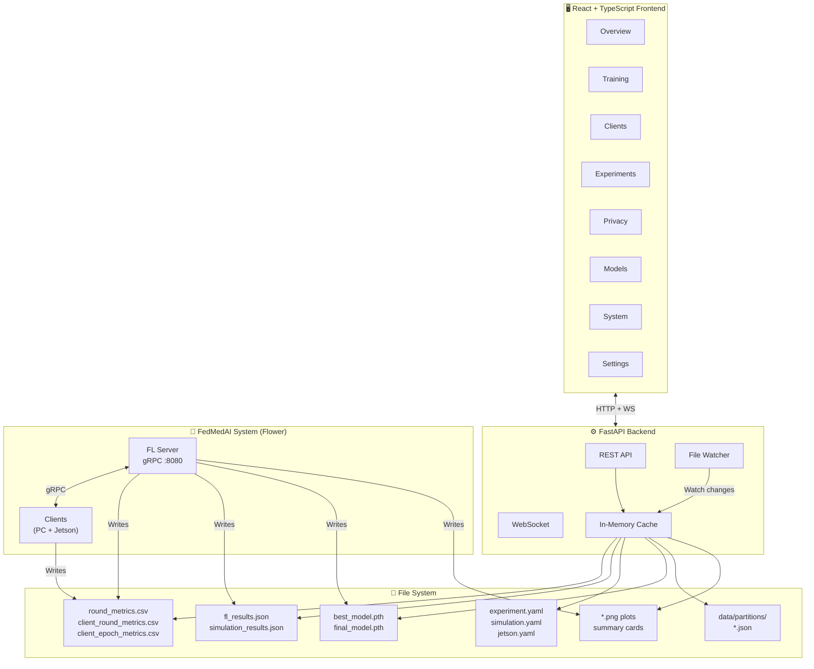

# 🏥 Prompt: Xây Dựng Dashboard Web cho Hệ Thống FedMedAI

````text
Xây dựng một giao diện Dashboard Web hoàn chỉnh cho hệ thống Federated Learning y tế 
"FedMedAI" với các yêu cầu chi tiết như sau:

═══════════════════════════════════════════════════════════════
 I. TỔNG QUAN HỆ THỐNG FedMedAI
═══════════════════════════════════════════════════════════════

FedMedAI là hệ thống Federated Learning (FL) y tế huấn luyện mô hình phân loại ảnh y tế 
phân tán trên nhiều bệnh viện/tổ chức mà KHÔNG tập trung dữ liệu bệnh nhân.

KIẾN TRÚC:
- Server trung tâm: Điều phối huấn luyện, tổng hợp model, đánh giá global
- Nhiều Clients (5–100): Mỗi client là một bệnh viện/thiết bị, huấn luyện cục bộ
- Framework: Flower (flwr >= 1.15.0), giao tiếp qua gRPC over TCP
- Server mặc định: 0.0.0.0:8080
- Hardware: PC (GPU) + Jetson Orin cluster

DATASETS (MedMNIST, ảnh 28×28, 3 kênh):
- bloodmnist: Tế bào máu ngoại vi (8 classes)
- pathmnist: Bệnh lý đại tràng (9 classes)
- organamnist: CT bụng (11 classes)

MODELS (3 kiến trúc CNN):
- cnn: Modern CNN (~20K params, BatchNorm + AdaptiveAvgPool)
- baseline: Classic 4-layer CNN (~570K params, KHÔNG có BatchNorm)
- baseline_bn: Classic 4-layer CNN (~571K params, CÓ BatchNorm, bắt buộc cho FedBN/FedBNS)

THUẬT TOÁN FL (10 strategies):
 1. fedavg      — Vanilla Federated Averaging (McMahan et al. 2017)
 2. fedprox     — Proximal regularization chống client drift (proximal_mu)
 3. fednova     — Normalized averaging bù đắp local step heterogeneity
 4. fedbn       — Local Batch Normalization giảm domain shift (ICLR 2021)
 5. scaffold    — Control variates correcting client drift (ICML 2020)
 6. fedbns      — ĐỀ XUẤT MỚI: FedBN + SCAFFOLD + Zero-Drift Masking
 7. fedsld      — Shared Label Distribution dynamic batch reweighting (ISBI 2022)
 8. fedsol      — Self-Centered Optimization with ExpSAM (CVPR 2024)
 9. fedswitch   — Stage-switching FL with DP Laplace histogram (MICCAI 2024)
10. proposed    — Alias cho fedbns (thuật toán đề xuất của nhóm nghiên cứu)

PHÂN CHIA DỮ LIỆU (Non-IID):
- Dirichlet: Concentration α ∈ {0.1, 0.3, 1.0}
- Practical: Mô phỏng phân bố lâm sàng thực tế 
  (K=12: [0.01]*10 + [0.1, 0.8] — 1 dominant, 1 medium, 10 nhỏ)

CHẾ ĐỘ CHẠY:
- Centralized Baseline: Train toàn bộ dataset tập trung (upper bound)
- Distributed FL: Triển khai vật lý PC + Jetson cluster qua LAN
- Automated Simulation: Chạy tự động server + N clients trên 1 máy

═══════════════════════════════════════════════════════════════
 II. DỮ LIỆU ĐẦU RA CỦA HỆ THỐNG (Dashboard đọc từ đây)
═══════════════════════════════════════════════════════════════

Dashboard cần đọc và hiển thị dữ liệu từ các nguồn sau:

1. fl_results.json — Metadata thí nghiệm + trajectory per-round + per-client stats
2. round_metrics.csv — Dữ liệu server-level mỗi round:
   round, round_time_seconds, total_elapsed_seconds, num_clients_reporting, 
   num_failures, train_loss, train_accuracy, epoch_time_avg/min/max, 
   client_train_time_avg/min/max, straggler_time, weight_size_kb_avg/total, 
   ping_ms_avg/min/max, server_c_norm (SCAFFOLD), local_steps_avg/min/max (FedNova)

3. client_round_metrics.csv — Dữ liệu per-client per-round:
   server_round, client_id, device_type, device_ipv4, num_samples, local_epochs,
   learning_rate, training_time, epoch_time_avg/min/max, train_loss, train_accuracy,
   ping_ms, weight_size_kb, cpu_percent, ram_percent, ram_used_mb, gpu_memory_mb,
   class_counts_json

4. client_epoch_metrics.csv — Dữ liệu granular per-epoch:
   round, client_id, device_type, epoch, epoch_time_seconds, 
   cumulative_epoch_time_seconds, train_loss, train_accuracy, learning_rate

5. Evaluation metrics (trong fl_results.json):
   - MCTA (Mean Client Test Accuracy): Trung bình accuracy trên clients
   - BMCTA (Best Mean Client Test Accuracy): Peak MCTA + round number
   - BTA (Best Test Accuracy): Best weighted combined accuracy
   - BMCTA Loss: Loss tại round BMCTA
   - WCTA (Weighted Client Test Accuracy)
   - Server global test accuracy/loss per round

6. simulation_summary.csv — Tổng hợp tất cả runs simulation
7. simulation_rounds_history.csv — Trajectory round-by-round của tất cả configs
8. Partition JSON files (data/partitions/) — Phân bố dữ liệu per-client
9. Ảnh biểu đồ đã generate: fl_training_curves.png, fl_summary_card.png, 
   confusion_matrix.png, client_training_time_comparison.png, v.v.
10. Model checkpoints: best_model.pth, final_model.pth

═══════════════════════════════════════════════════════════════
 III. THIẾT KẾ GIAO DIỆN DASHBOARD (8 TRANG)
═══════════════════════════════════════════════════════════════

THIẾT KẾ TỔNG QUAN:
- SPA (Single Page Application), responsive, dark/light mode
- Sidebar navigation 8 mục chính (icons + labels)
- Header: logo FedMedAI, breadcrumb, notifications bell, user profile
- Theme: Medical/Healthcare — tông xanh dương (#1565C0), trắng, xám nhạt (#F5F5F5)
  Accent: xanh lá (#2E7D32) cho success, đỏ (#C62828) cho error, cam (#E65100) cho warning
- Typography: Inter/Roboto, font chuyên nghiệp, dễ đọc trên dashboard
- Tất cả biểu đồ phải interactive: hover tooltip, zoom, pan, click-to-drill-down


──────────────────────────────────────────────────────────────
 TRANG 1: DASHBOARD OVERVIEW (Tổng quan)
──────────────────────────────────────────────────────────────
Mục tiêu: Cái nhìn tổng thể toàn hệ thống trong MỘT trang duy nhất.

ROW 1 — Status Cards (6 cards ngang):
┌──────────┐ ┌──────────┐ ┌──────────┐ ┌──────────┐ ┌──────────┐ ┌──────────┐
│ 🟢 Status │ │ Round    │ │ Clients  │ │ BMCTA    │ │ BTA      │ │ Strategy │
│ Running  │ │ 45/80    │ │ 8/12     │ │ 87.3%    │ │ 89.1%    │ │ fedbns   │
└──────────┘ └──────────┘ └──────────┘ └──────────┘ └──────────┘ └──────────┘

ROW 2 — Biểu đồ chính (2 cột):
LEFT (60%):
- Dual-axis line chart: Global Accuracy (MCTA) & Loss theo rounds
- Toggle hiển thị: train_accuracy, MCTA, BTA line, server_eval_accuracy

RIGHT (40%):
- Progress ring lớn: % rounds hoàn thành (45/80 = 56.25%)
- Bên trong ring: Thời gian đã chạy / ước tính còn lại
- Dưới ring: Throughput (rounds/hour), straggler_time trung bình

ROW 3 — Thông tin bổ sung (2 cột):
LEFT:
- Bar chart: Phân bố train_accuracy trên các clients ở round hiện tại
- Mỗi bar là 1 client, màu theo device_type (PC=xanh, Orin=cam)

RIGHT:
- Recent Activity Feed (timeline vertical):
  • "Round 45 completed — MCTA: 87.3%, 12/12 clients reported"
  • "Client 5 (jetson_orin) straggler — 23.4s vs avg 8.2s"
  • "New best BMCTA: 87.3% at round 45"
  • "Checkpoint saved: best_model.pth"

ROW 4 — Quick Stats Cards (4 cards):
┌──────────────┐ ┌──────────────┐ ┌──────────────┐ ┌──────────────┐
│ Total Time   │ │ Avg Round    │ │ Total Comm   │ │ Failures     │
│ 2h 34m 12s   │ │ 12.3s        │ │ 1.2 GB       │ │ 3 rounds     │
└──────────────┘ └──────────────┘ └──────────────┘ └──────────────┘


──────────────────────────────────────────────────────────────
 TRANG 2: TRAINING MONITOR (Giám sát Huấn luyện)
──────────────────────────────────────────────────────────────
Mục tiêu: Giám sát chi tiết quá trình huấn luyện FL, hỗ trợ phân tích convergence.

SECTION A — Real-time Training Status:
- Thanh tiến trình round hiện tại: N/M clients đã gửi update
- Pipeline phases: [Client Selection] → [Local Training] → [Upload] → [Aggregation] → [Broadcast]
  Mỗi phase highlighted khi đang active
- Thời gian ước tính còn lại dựa trên avg round_time_seconds

SECTION B — Performance Charts (tabs hoặc grid 2×2):
Tab 1: Accuracy Curves
  - Multi-line: train_accuracy (weighted avg), MCTA, server_eval_accuracy theo rounds
  - Đánh dấu BMCTA point và BTA point trên chart
  - Shaded area: min-max accuracy range trên clients

Tab 2: Loss Curves  
  - train_loss theo rounds
  - BMCTA_loss marker
  - Smoothing slider (EMA factor)

Tab 3: Client Heatmap
  - Heatmap 2D: client_id (Y-axis) × round (X-axis), color = train_accuracy
  - Hover tooltip: client_id, round, accuracy, loss, device_type, training_time
  - Sort clients by: average accuracy, device_type, num_samples

Tab 4: Training Time Analysis
  - Stacked area chart: client_train_time_avg vs communication overhead vs aggregation
  - Per-round breakdown: round_time_seconds
  - Straggler detection: highlight rounds where straggler_time > 2× avg

SECTION C — Convergence Analysis:
- Gradient divergence indicator: server_c_norm (SCAFFOLD/FedBNS) theo rounds
- Local steps variance: local_steps_avg/min/max (FedNova) theo rounds
- Warning banner khi: loss tăng 3 rounds liên tiếp, hoặc accuracy giảm > 5%

SECTION D — Communication Metrics:
- weight_size_kb_total theo rounds (line chart)
- ping_ms per client (box plot mỗi round)
- Bandwidth breakdown: upload vs download estimated


──────────────────────────────────────────────────────────────
 TRANG 3: CLIENT MANAGEMENT (Quản lý Client)  
──────────────────────────────────────────────────────────────
Mục tiêu: Quản lý, giám sát và so sánh từng client/bệnh viện.

SECTION A — Client Table:
| Client ID | Device Type | IP Address | Samples | Classes | Status | Accuracy | Loss | Ping |
Columns sortable, filterable. Device type badges: 🖥️ PC, 🟧 Orin
Search by client_id hoặc device_type

SECTION B — Client Detail Drawer (slide-in panel khi click 1 client):
Header: Client #{id} — {device_type} @ {device_ipv4}
Sub-sections:
  1. Overview: num_samples, local_epochs, learning_rate, device specs
  2. Training History: Line chart train_accuracy & train_loss qua các rounds
  3. Epoch Detail: Expandable per-round → epoch_time_seconds, train_loss, train_accuracy
  4. Data Distribution: 
     - Pie/Donut chart: class_counts_json (phân bố nhãn local)
     - So sánh với global distribution (overlay)
  5. Resource Usage: cpu_percent, ram_percent, ram_used_mb, gpu_memory_mb qua rounds
  6. Network: ping_ms history, weight_size_kb per round

SECTION C — Client Comparison Tool:
- Multi-select 2–6 clients
- Overlay line charts: accuracy & loss curves
- Radar chart (spider): accuracy, loss (inverted), speed, data_size, participation
- Grouped bar: training_time comparison per round

SECTION D — Data Heterogeneity Visualization:
- Stacked bar chart: Phân bố nhãn trên TẤT CẢ clients (thể hiện non-IID)
  Đọc từ partition JSON: clients[i].class_distribution
- Annotation: Partition mode (dirichlet/practical), alpha value
- Heatmap: Cosine similarity giữa class distributions của các cặp clients
- Table summary: Per-client → num_samples, num_classes_present, dominant_class, Gini index


──────────────────────────────────────────────────────────────
 TRANG 4: EXPERIMENT MANAGEMENT (Quản lý Thí nghiệm)
──────────────────────────────────────────────────────────────
Mục tiêu: Tạo, quản lý, so sánh nhiều thí nghiệm FL.

SECTION A — Experiment List Table:
| Exp ID | Name | Dataset | Partition | Strategy | Model | Rounds | Status | BMCTA | BTA | Time |
Actions: ▶ Start, ⏸ Pause, ⏹ Stop, 📋 Duplicate, 🗑 Delete, 📊 Compare
Filter by: dataset, strategy, partition, status

SECTION B — New Experiment Form (modal hoặc trang riêng):
Organized into collapsible sections:

📊 Dataset & Model:
  - Dataset: Dropdown [bloodmnist, pathmnist, organamnist]
  - Model: Dropdown [cnn (~20K), baseline (~570K), baseline_bn (~571K)]
    Note: baseline_bn bắt buộc khi dùng FedBN/FedBNS
  - Augmentation: Toggle [random_crop, random_flip]

🔧 Training Hyperparameters:
  - num_rounds: Number input (1–500, default 80)
  - local_epochs: Number input (1–20, default 5)
  - batch_size: Dropdown [16, 32, 64, 128, 256]
  - learning_rate: Number input (0.0001–0.1, default 0.01)
  - optimizer: Dropdown [SGD, Adam, AdamW]
  - momentum: Slider (0–0.99, default 0.9, chỉ hiện khi SGD)
  - weight_decay: Number input (default 0)
  - LR Mode: Radio [fixed, server_decay, client_loss]
    - Nếu server_decay: lr_decay_steps, lr_decay_gamma, server_lr_min
    - Nếu client_loss: client_lr_patience, client_lr_factor, client_lr_min
  - clip_grad_norm: Number input (optional)
  - seed: Number input (default 42)

🏥 Federated Settings:
  - num_clients: Slider (5–100, default 12)
  - min_clients: Number input (default = num_clients)
  - fraction_fit: Slider (0.1–1.0, default 1.0)
  - local_test: Toggle (default true)

📦 Data Partition:
  - Mode: Radio [dirichlet, practical]
  - Nếu Dirichlet: alpha slider (0.1–100.0, default 0.3)
  - Preview: Hiển thị mô tả phân bố (vd: "Practical: 1 dominant (80%), 
    1 medium (10%), 10 small (1% each)")

🧠 Algorithm (Strategy):
  - Strategy: Dropdown [fedavg, fedprox, fednova, fedbn, scaffold, fedbns/proposed, 
    fedsld, fedsol, fedswitch]
  - Conditional fields (hiện khi chọn strategy tương ứng):
    ├─ FedProx: proximal_mu (default 0.01)
    ├─ FedSLD: fedsld_epsilon (default 1e-6), fedsld_reduction [mean, sum]
    ├─ FedSOL: fedsol_rho (default 2.0), fedsol_target [head, all], 
    │          fedsol_loss_type [kl, l2], fedsol_temperature (default 3.0),
    │          fedsol_adaptive (toggle)
    └─ FedSwitch: switch_round (auto hoặc manual), fedswitch_coverage (default 0.9),
                  fedswitch_epsilon (default 1.0), fedswitch_c_bound (default 50),
                  fedswitch_weighting_mode [bounded_sum, stratified]

🛑 Early Stopping:
  - early_stop_patience: Number input (0 = disabled)
  - early_stop_metric: Dropdown [accuracy, loss]

💾 Server:
  - host: Text input (default 0.0.0.0)
  - port: Number input (default 8080)
  - server_eval: Toggle (default true, auto-disabled for FedBN strategies)

Buttons: [Start Experiment] [Save as Draft] [Export Config YAML]
Validation: Hiện warning nếu chọn FedBN/FedBNS với model=baseline (không có BN)

SECTION C — Experiment Comparison:
- Checkbox chọn 2–5 experiments
- Overlay accuracy curves (MCTA) trên cùng 1 chart, legend = strategy + dataset
- Overlay loss curves
- Comparison table:
  | Metric | Exp 1 | Exp 2 | Exp 3 |
  |--------|-------|-------|-------|
  | BMCTA  | 87.3% | 85.1% | 89.2% |
  | BMCTA Round | 45 | 38 | 62 |
  | BTA    | 89.1% | 86.5% | 90.3% |
  | Final Loss | 0.42 | 0.51 | 0.38 |
  | Total Time | 2h34m | 1h52m | 3h15m |
  | Convergence | Round 35 | Round 28 | Round 50 |
- Parallel coordinates plot: hyperparameter → performance mapping

SECTION D — Experiment Detail (click vào 1 experiment):
- Full config viewer (YAML syntax highlighted)
- All training curves
- fl_results.json viewer (collapsible JSON tree)
- Controls: Stop, Pause, Resume, Export Results (CSV/JSON), Download Model (.pth)


──────────────────────────────────────────────────────────────
 TRANG 5: PRIVACY & SECURITY (Quyền riêng tư & Bảo mật)
──────────────────────────────────────────────────────────────
Mục tiêu: Giám sát cơ chế bảo mật và privacy trong FL.

SECTION A — Differential Privacy (FedSwitch):
- Indicator: DP enabled/disabled cho experiment hiện tại
- Gauge chart: fedswitch_epsilon (DP budget consumed)
- Line chart: DP noise impact — accuracy with/without DP across rounds
- Parameters display: fedswitch_epsilon, fedswitch_c_bound, 
  fedswitch_coverage, weighting_mode
- Phase indicator: Phase 1 (balanced + DP) vs Phase 2 (standard) — 
  highlight switch_round

SECTION B — Gradient Protection:
- clip_grad_norm value hiện tại
- Chart: Distribution of gradient norms per client per round (violin plot)
- % updates bị clipped mỗi round

SECTION C — Model Update Anomaly Detection:
- Per-client: L2 norm of model update mỗi round (line chart, 1 line per client)
- Outlier detection: Highlight clients với update norm > 3σ from mean
- Alert list: "Client X round Y: update norm 15.3 (avg: 2.1) — potential poisoning"
- Per-layer drift statistics visualization

SECTION D — Communication Security:
- gRPC connection status per client (TLS info)
- Connection uptime history
- Failed connection attempts log

SECTION E — Audit Log:
- Table: Timestamp | Event Type | Actor | Details
- Events: experiment_started, round_completed, client_joined, client_failed, 
  model_saved, early_stop_triggered
- Filter by event type, time range, client
- Export audit log as CSV


──────────────────────────────────────────────────────────────
 TRANG 6: MODEL REGISTRY (Kho Mô hình)
──────────────────────────────────────────────────────────────
Mục tiêu: Quản lý phiên bản mô hình đã huấn luyện.

SECTION A — Model List:
| Version | Experiment | Strategy | Dataset | Round | BMCTA | BTA | Size | Date |
Actions: Download .pth, Compare, Deploy, Delete
Filter by: dataset, strategy, model architecture

SECTION B — Model Detail:
- Architecture card: Tên model, số params, layer summary
- Performance tại checkpoint: accuracy, loss, MCTA, BMCTA, BTA
- Confusion matrix heatmap (nếu có confusion_matrix.png)
- Per-class metrics table: precision, recall, F1 cho từng class
  (bloodmnist: 8 classes, pathmnist: 9, organamnist: 11)
- Training curve mini-chart: accuracy trajectory đến round checkpoint

SECTION C — Model Comparison:
- Side-by-side 2–3 models
- Overlay confusion matrices
- Grouped bar: per-class F1 comparison
- Delta table: Metric differences highlighted (green = better, red = worse)

SECTION D — Centralized Baseline Reference:
- Hiển thị kết quả centralized training (upper bound) để so sánh
- Metrics gap: FL accuracy vs. centralized accuracy


──────────────────────────────────────────────────────────────
 TRANG 7: SYSTEM MONITOR (Giám sát Hệ thống)
──────────────────────────────────────────────────────────────
Mục tiêu: Giám sát tài nguyên phần cứng real-time.

SECTION A — Server Resources:
- CPU usage line chart (real-time, 30s window)
- RAM usage: gauge + line chart
- GPU utilization + GPU memory (nếu có)
- Disk I/O indicators
- Network bandwidth: gRPC in/out

SECTION B — Client Fleet Overview:
- Table with live indicators:
  | Client | Device | IP | CPU% | RAM% | RAM MB | GPU MB | Ping ms | Status |
- Color coding: 🟢 <50%, 🟡 50-80%, 🔴 >80%
- Heatmap: Resource utilization across clients over time

SECTION C — Hardware Profiles (từ jetson.yaml):
- Cards cho mỗi profile:
  ┌──────────────────┐  ┌──────────────────┐
  │ 🖥️ PC             │  │ 🟧 Jetson Orin    │
  │ Batch: 32        │  │ Batch: 32        │
  │ Workers: 0       │  │ Workers: 2       │
  │ Pin Memory: ✅    │  │ Pin Memory: ❌    │
  │ Clients: PC nodes│  │ Clients: Orin    │
  └──────────────────┘  └──────────────────┘
- Client registry mapping visualization

SECTION D — Alerts & Notifications:
- Alert rules: Client offline > 30s, GPU OOM, Ping > 500ms, CPU > 95%
- Alert history with severity: Info 🔵, Warning 🟡, Critical 🔴
- Straggler alerts: When straggler_time > 3× average round time
- Failure counter: num_failures per round trend


──────────────────────────────────────────────────────────────
 TRANG 8: SETTINGS (Cài đặt)
──────────────────────────────────────────────────────────────

1. General:
   - System name, timezone, language (Vietnamese / English)
   - Default result output directory
   - Auto-save interval

2. Server Configuration:
   - Default gRPC host/port
   - Default min_clients
   - Checkpoint save interval
   - Maximum concurrent experiments

3. Notifications:
   - Email alerts: training complete, error, early stop triggered
   - Slack webhook integration
   - In-app notification preferences

4. Display:
   - Theme: Dark / Light / System
   - Chart default settings: smoothing, animation, color palette
   - Table default: page size, default sort

5. Data Management:
   - Partition directory path
   - Results directory path  
   - Auto-cleanup old results (days retention)
   - Storage usage summary

6. User Management:
   - Roles: Admin, Researcher, Viewer
   - Activity log per user

7. Export & Reporting:
   - Default export format: CSV, JSON, PDF
   - Auto-generate report after experiment completion
   - Chart export format: PNG, SVG

═══════════════════════════════════════════════════════════════
 IV. YÊU CẦU KỸ THUẬT
═══════════════════════════════════════════════════════════════

FRONTEND STACK:
─────────────
- Framework: React 18+ với TypeScript
- UI Library: Material UI (MUI) v5+ — phù hợp medical/professional theme
- State Management: Zustand (lightweight) hoặc Redux Toolkit
- Charts: Apache ECharts (cho heatmap, complex charts) + Recharts (cho simple charts)
- Tables: TanStack Table (sorting, filtering, pagination, virtual scroll)
- Forms: React Hook Form + Zod schema validation
- Routing: React Router v6 (lazy loading per page)
- Real-time: WebSocket (native hoặc Socket.IO)
- Internationalization: react-i18next (VN + EN)
- Icons: Material Icons + Lucide React
- Date handling: date-fns hoặc dayjs

BACKEND API STACK:
──────────────────
- Framework: FastAPI (Python) — tích hợp dễ với hệ thống FL Python hiện tại
- Database: SQLite (development) / PostgreSQL (production) cho experiment metadata
- File reading: Đọc trực tiếp CSV/JSON/YAML từ results/ và configs/
- WebSocket: FastAPI WebSocket endpoints
- CORS: Enabled cho frontend dev server

API ENDPOINTS:
──────────────
# System
GET    /api/status                        — Trạng thái hệ thống (running/idle/error)
GET    /api/health                        — Health check

# Experiments  
GET    /api/experiments                   — List all experiments
POST   /api/experiments                   — Create new experiment
GET    /api/experiments/{id}              — Detail (config + results)
PUT    /api/experiments/{id}/control      — Start/Stop/Pause/Resume
DELETE /api/experiments/{id}              — Delete experiment
GET    /api/experiments/{id}/config       — Get YAML config
POST   /api/experiments/compare           — Compare selected experiments

# Training Rounds
GET    /api/experiments/{id}/rounds       — Round metrics (round_metrics.csv)
GET    /api/experiments/{id}/rounds/{r}   — Single round detail

# Clients
GET    /api/experiments/{id}/clients      — Client list with latest metrics
GET    /api/experiments/{id}/clients/{c}  — Client detail
GET    /api/experiments/{id}/clients/{c}/rounds   — Client round history
GET    /api/experiments/{id}/clients/{c}/epochs    — Client epoch history

# Data & Partitions
GET    /api/partitions                    — List available partition files
GET    /api/partitions/{name}             — Partition detail (distribution)

# Models
GET    /api/models                        — Model registry list
GET    /api/models/{id}                   — Model detail + metrics
GET    /api/models/{id}/download          — Download .pth file
POST   /api/models/compare                — Compare models

# System Monitoring
GET    /api/system/resources              — Current server resources
GET    /api/system/hardware-profiles      — Jetson.yaml profiles
GET    /api/system/alerts                 — Active + historical alerts

# Privacy
GET    /api/experiments/{id}/privacy      — DP metrics, gradient norms

# Audit
GET    /api/audit-log                     — System audit log

# Real-time WebSocket
WS     /ws/training/{experiment_id}       — Live training updates
WS     /ws/system                         — Live system resource metrics

DATA FLOW:
──────────
Backend reads → CSV/JSON/YAML files in results/, configs/, data/partitions/
Backend watches → File system changes for real-time updates
Backend caches → Parsed data in memory with TTL
Frontend polls → REST API (5-10s interval) or WebSocket for live data

═══════════════════════════════════════════════════════════════
 V. TÍNH NĂNG BỔ SUNG
═══════════════════════════════════════════════════════════════

1. SIMULATION BENCHMARK VIEW:
   - Đọc simulation_summary.csv và simulation_rounds_history.csv
   - Cross-comparison matrix: Dataset × Strategy × Partition → BMCTA, BTA
   - Heatmap tổng hợp: nhanh chóng thấy combo nào tốt nhất

2. EXPORT & REPORTING:
   - Export bất kỳ chart → PNG/SVG
   - Generate PDF report cho 1 experiment (template: summary card + all charts)
   - Export raw data → CSV
   - 1-click generate simulation_report.md

3. RESPONSIVE DESIGN:
   - Desktop-first (1920×1080 primary target)
   - Tablet-friendly (collapsible sidebar, stacked layouts)
   - Minimum: 1024px width

4. ACCESSIBILITY:
   - Color-blind friendly chart palettes (Viridis, Cividis)
   - ARIA labels, keyboard navigation
   - High contrast mode option

5. PERFORMANCE:
   - Code splitting + lazy loading per page
   - Chart data sampling khi >500 data points
   - Virtual scrolling cho tables >100 rows
   - API response caching (SWR / React Query)

6. CONFIG YAML EDITOR:
   - In-browser YAML editor với syntax highlighting
   - Schema validation real-time
   - Load/Save experiment configs

═══════════════════════════════════════════════════════════════
 VI. MOCKUP LAYOUT
═══════════════════════════════════════════════════════════════

┌─────────────────────────────────────────────────────────────────────┐
│  🏥 FedMedAI Dashboard     [experiment ▾]   🔔 3   🌙/☀️   👤 Admin │
├────────────┬────────────────────────────────────────────────────────┤
│            │                                                        │
│ 📊 Overview│  ┌───────┐ ┌───────┐ ┌───────┐ ┌───────┐ ┌───────┐   │
│ 📈 Training│  │🟢 Run │ │R 45/80│ │C 12/12│ │BMCTA  │ │BTA    │   │
│ 🏥 Clients │  │       │ │  56%  │ │ 100%  │ │87.3%  │ │89.1%  │   │
│ 🧪 Expts   │  └───────┘ └───────┘ └───────┘ └───────┘ └───────┘   │
│ 🔒 Privacy │                                                        │
│ 📦 Models  │  ┌──────────────────────────┐ ┌───────────────────┐   │
│ 💻 System  │  │  MCTA & Loss over Rounds │ │   ◯ 56.25%        │   │
│ ⚙ Settings │  │  ╱‾‾‾╲___               │ │   Progress        │   │
│            │  │ ╱        ‾‾‾─── MCTA     │ │   2h 34m elapsed  │   │
│            │  │╱   ╲__─────── Loss       │ │   ~1h 52m remain  │   │
│            │  └──────────────────────────┘ └───────────────────┘   │
│ ─ ─ ─ ─ ─ │                                                        │
│ Datasets:  │  ┌──────────────────────────┐ ┌───────────────────┐   │
│  bloodmnist│  │ Client Accuracy Dist.    │ │ Recent Activity   │   │
│  pathmnist │  │ ▌▌▌▌▌▌▌▌▌▌▌▌           │ │ • R45 done ✅      │   │
│  organamnist│ │ 🖥️🟧🟧🟧🟧🟧🟧🟧🟧🟧🖥️🖥️│ │ • BMCTA↑ 87.3%    │   │
│            │  │ c0 c1 c2 c3 c4 ...      │ │ • Straggler c5 ⚠️ │   │
│            │  └──────────────────────────┘ └───────────────────┘   │
└────────────┴────────────────────────────────────────────────────────┘

═══════════════════════════════════════════════════════════════
 VII. ƯU TIÊN PHÁT TRIỂN (PHASES)
═══════════════════════════════════════════════════════════════

Phase 1 — MVP (2 tuần):
  ✅ Project setup (React + TypeScript + MUI + FastAPI)
  ✅ Dashboard Overview (đọc round_metrics.csv + fl_results.json)
  ✅ Training Monitor (charts từ CSV data)
  ✅ Basic Client Management (table + detail)
  → Sử dụng file-based data (đọc trực tiếp CSV/JSON, chưa cần DB)

Phase 2 — Core Features (2 tuần):
  ✅ Experiment Management (form tạo experiment + YAML generation)
  ✅ Model Registry (list + download + basic comparison)
  ✅ Simulation Benchmark View
  → Thêm SQLite cho experiment metadata

Phase 3 — Advanced (1-2 tuần):
  ✅ Privacy & Security dashboard
  ✅ System Monitor (resource metrics)
  ✅ Client comparison tools + data heterogeneity viz

Phase 4 — Polish (1 tuần):
  ✅ Settings page
  ✅ Dark/Light mode
  ✅ i18n (Vietnamese + English)
  ✅ PDF report generation
  ✅ Export functionality

Phase 5 — Real-time (1 tuần):
  ✅ WebSocket integration cho live training updates
  ✅ Alert system
  ✅ File watcher cho auto-refresh khi có dữ liệu mới

Hãy bắt đầu với Phase 1: Tạo project structure, implement Dashboard Overview và 
Training Monitor đọc dữ liệu từ file CSV/JSON có sẵn trong thư mục results/.
Sử dụng mock data nếu chưa có file thật.
````

---

## Sơ Đồ Kiến Trúc



## Mapping: Thuật Toán → Dashboard Features

| Strategy | Dashboard-Specific Features |
|----------|---------------------------|
| **FedAvg** | Baseline curves, standard metrics |
| **FedProx** | Show `proximal_mu` value, proximal loss component |
| **FedNova** | `local_steps_avg/min/max` chart, normalized weight viz |
| **FedBN** | Per-client BN stats, note: server eval disabled |
| **SCAFFOLD** | `server_c_norm` tracking, control variate magnitude |
| **FedBNS** | Zero-Drift Mask indicator, combined BN+SCAFFOLD viz |
| **FedSLD** | Batch reweighting factors, shared distribution viz |
| **FedSOL** | ExpSAM perturbation magnitude, KL/L2 discrepancy |
| **FedSwitch** | Phase 1/2 indicator, `switch_round` marker, DP budget |

