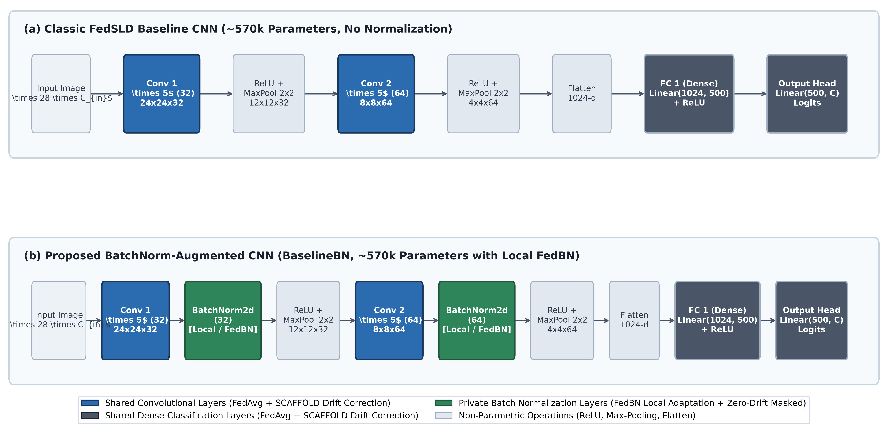

# METHODOLOGY

## Benchmark Reproduction and Experimental Foundation (FedSLD)

To establish a solid and fair baseline for our study, we begin by
reproducing the benchmark from the FedSLD paper (Luo & Wu, ISBI 2022) .
FedSLD is a well-known federated learning study designed specifically
for medical image classification under non-IID data distributions. In
this section, we describe the datasets, the non-IID partitioning method,
the experimental configuration, the foundational baseline algorithms
(FedAvg and FedProx), and the reproduced benchmark results.

### Benchmark Datasets: Focus on PathMNIST and OrganAMNIST

The MedMNIST v2 collection provides standardized 2D biomedical image
datasets for machine learning research. While the collection includes
several datasets (such as BloodMNIST and DermaMNIST), this research
focuses primarily on two representative benchmarks:

1.  **PathMNIST**: A dataset of colon pathology images containing 9
    diagnostic classes (such as adipose, debris, lymphocytes, and tumor
    epithelium). It exhibits significant variations in tissue textures
    and histological staining.

2.  **OrganAMNIST**: A dataset of abdominal CT organ patches featuring
    11 anatomical classes (such as liver, kidneys, spleen, and bladder).
    It presents subtle grayscale differences across diverse organs.

Other datasets in the collection, such as BloodMNIST (blood cell
classification) and DermaMNIST (dermatoscopy skin lesion screening), are
also supported in our codebase, but PathMNIST and OrganAMNIST serve as
the core evaluation benchmarks in this thesis.

### Data Partitioning: Practical versus Pathological Non-IID

In the FedSLD benchmark , the authors evaluate federated learning under
two distinct non-IID partitioning schemes:

- **Pathological Non-IID**: Originally introduced in the foundational
  FedAvg paper , this classic scheme artificially restricts each client
  to hold samples from only a few classes (for example, exactly 2
  classes per hospital). While it creates extreme label skew to test
  theoretical convergence, it is unrealistic in healthcare because
  actual hospitals treat a diverse spectrum of diseases, rather than
  just one or two specific conditions.

- **Practical Non-IID**: To overcome the artificial nature of the
  pathological split, FedSLD designed the Practical partition, which
  reflects clinical reality much more accurately. In real-world
  healthcare collaborations, medical institutions differ substantially
  in size, patient volume, and diagnostic specialization.

Specifically, for $`K = 12`$ clients, the Practical partition applies
clinical proportions **independently for each individual class**, rather
than as a single global split across the entire dataset:

- For every diagnostic category, the samples belonging to that class are
  divided into 12 shards: one dominant shard containing **80%** of the
  class samples, one medium shard containing **10%**, and ten small
  shards sharing the remaining **10%** equally (**1%** each).

- These shards are then randomly assigned across the 12 clients for each
  class.

As a result of this per-class sharding mechanism, a single client can be
assigned the 80% dominant shard for multiple disease categories. This
accurately simulates large specialized medical centers that receive a
high volume of cases across several related conditions (for instance, in
PathMNIST, one large client holds the 80% dominant shards for three
different classes, totaling over 26,000 samples). Meanwhile, other
clients receive only small 1% shards across all classes (simulating
small local clinics with under 900 samples). This partitioning strategy
creates realistic volume disparities (a $`\sim`$<!-- -->29$`\times`$
sample count difference between the largest and smallest clients)
alongside natural clinical specialization, while guaranteeing that all
clients retain at least a baseline number of samples for every class.

### Baseline Algorithms: FedAvg and FedProx

To evaluate model performance, we implement and reproduce two
foundational federated learning algorithms:

1.  **FedAvg (Federated Averaging)** : The classic baseline algorithm.
    In each round, the central server sends the current global model to
    the clients. Each client trains the model on its local data using
    SGD and sends the updated weights back. The server then computes a
    weighted average of these weights based on each client’s sample
    count:
    ``` math
    \begin{equation}
            w^{(r+1)} = \sum_{k=1}^K \frac{n_k}{N} w_k^{(r+1)}
            \label{eq:fedavg_simple}
    \end{equation}
    ```
    When data across clients is heavily non-IID, local models tend to
    move toward their local optima, causing the global model to suffer
    from *client drift*.

2.  **FedProx (Federated Proximal)** : An extension of FedAvg designed
    to improve stability under heterogeneity. FedProx adds a proximal
    regularization term to each client’s local loss function:
    ``` math
    \begin{equation}
            \min_{w} \mathcal{L}_k(w) = F_k(w) + \frac{\mu}{2} \|w - w^{(r)}\|^2
            \label{eq:fedprox_simple}
    \end{equation}
    ```
    where $`\mu > 0`$ is a proximal penalty parameter (we use
    $`\mu = 0.01`$). This term keeps local model updates closer to the
    global model $`w^{(r)}`$, helping to reduce client drift.

### Experimental Configuration

To reproduce the FedSLD benchmark faithfully and ensure fair
comparisons, we adopt the exact experimental parameters specified in the
FedSLD paper:

- **Number of Clients**: $`K = 12`$ clients participating in federated
  training.

- **Communication Rounds**: 80 rounds.

- **Local Epochs**: 5 local epochs per client in each round.

- **Mini-Batch Size**: 256.

- **Optimizer**: Stochastic Gradient Descent (SGD) with momentum
  $`\mu = 0.9`$ and weight decay $`10^{-4}`$.

- **Learning Rate**: Initial learning rate $`\eta = 0.01`$ (with a fixed
  schedule across rounds).

- **Network Architecture**: In their implementation details, Luo & Wu
  specify: *“We use the classic four-layer CNN model with two
  $`5\times 5`$ convolutional layers and two fully connected layers
  (hidden layer has 500 units)”*, following the standard federated
  benchmark model established by McMahan et al. . This architecture
  comprises $`\sim`$<!-- -->570k parameters and operates without Batch
  Normalization layers.

Importantly, for our proposed method, we maintain this exact
experimental configuration and strictly follow the partitioning design
of the original paper—dividing each class into 12 shards according to
the 80%–10%–1% clinical proportions. This guarantees that all subsequent
performance comparisons and gains stem directly from algorithmic
improvements rather than different hyper-parameters or altered partition
settings.

### Reproduction Results and Baseline Selection

Table <a href="#tab:fedsld_repro_comparison" data-reference-type="ref"
data-reference="tab:fedsld_repro_comparison">1.1</a> compares the
original results published in the FedSLD paper against our reproduction
across both PathMNIST and OrganAMNIST under the Practical non-IID
partition. For our reproduction, we report the mean and standard
deviation across independent runs. We evaluate performance using the two
official FedSLD metrics:

- **BMCTA (Best Mean Client Test Accuracy)**: The average test accuracy
  computed across each of the 12 individual client local test sets.

- **BTA (Best Total Accuracy)**: The overall test accuracy evaluated on
  the pooled global test set.

<div id="tab:fedsld_repro_comparison">

<table>
<caption>Benchmark results under Practical Non-IID partition (12
clients, 80 rounds) compared with original FedSLD paper and Centralized
Upper Bound.</caption>
<thead>
<tr>
<th style="text-align: left;"><strong>Dataset</strong></th>
<th style="text-align: left;"><strong>Method / Algorithm</strong></th>
<th colspan="2" style="text-align: center;"><strong>FedSLD Paper <span
class="citation" data-cites="luo2022fedsld"></span></strong></th>
<th colspan="2" style="text-align: center;"><strong>Our
Reproduction</strong></th>
</tr>
</thead>
<tbody>
<tr>
<td style="text-align: left;"><span>3-4</span> (lr)<span>5-6</span></td>
<td style="text-align: left;"></td>
<td style="text-align: center;"><strong>BMCTA (%)</strong></td>
<td style="text-align: center;"><strong>BTA (%)</strong></td>
<td style="text-align: center;"><strong>BMCTA (%)</strong></td>
<td style="text-align: center;"><strong>BTA (%)</strong></td>
</tr>
<tr>
<td rowspan="4" style="text-align: left;">OrganAMNIST</td>
<td style="text-align: left;">Centralized (Upper Bound)</td>
<td style="text-align: center;">—</td>
<td style="text-align: center;">—</td>
<td style="text-align: center;"><span
class="math inline">81.99 ± 0.84</span></td>
<td style="text-align: center;"><span
class="math inline">81.99 ± 0.84</span></td>
</tr>
<tr>
<td style="text-align: left;">FedAvg</td>
<td style="text-align: center;"><span
class="math inline">82.32</span></td>
<td style="text-align: center;"><span
class="math inline">85.69</span></td>
<td style="text-align: center;"><span
class="math inline">82.39 ± 0.84</span></td>
<td style="text-align: center;"><span
class="math inline">82.98 ± 0.85</span></td>
</tr>
<tr>
<td style="text-align: left;">FedProx</td>
<td style="text-align: center;"><span
class="math inline">81.53</span></td>
<td style="text-align: center;"><span
class="math inline">85.54</span></td>
<td style="text-align: center;"><span
class="math inline">82.29 ± 0.81</span></td>
<td style="text-align: center;"><span
class="math inline">82.88 ± 0.84</span></td>
</tr>
<tr>
<td style="text-align: left;">FedSLD (Paper Method)</td>
<td style="text-align: center;"><span
class="math inline">84.75</span></td>
<td style="text-align: center;"><span
class="math inline">87.37</span></td>
<td style="text-align: center;">—</td>
<td style="text-align: center;">—</td>
</tr>
<tr>
<td rowspan="4" style="text-align: left;">PathMNIST</td>
<td style="text-align: left;">Centralized (Upper Bound)</td>
<td style="text-align: center;">—</td>
<td style="text-align: center;">—</td>
<td style="text-align: center;"><span
class="math inline">77.11 ± 1.33</span></td>
<td style="text-align: center;"><span
class="math inline">77.11 ± 1.33</span></td>
</tr>
<tr>
<td style="text-align: left;">FedAvg</td>
<td style="text-align: center;"><span
class="math inline">52.70</span></td>
<td style="text-align: center;"><span
class="math inline">57.38</span></td>
<td style="text-align: center;"><span
class="math inline">77.76 ± 2.05</span></td>
<td style="text-align: center;"><span
class="math inline">79.44 ± 1.26</span></td>
</tr>
<tr>
<td style="text-align: left;">FedProx</td>
<td style="text-align: center;"><span
class="math inline">52.77</span></td>
<td style="text-align: center;"><span
class="math inline">57.72</span></td>
<td style="text-align: center;"><span
class="math inline">77.99 ± 1.93</span></td>
<td style="text-align: center;"><span
class="math inline">79.75 ± 0.76</span></td>
</tr>
<tr>
<td style="text-align: left;">FedSLD (Paper Method)</td>
<td style="text-align: center;"><span
class="math inline">53.87</span></td>
<td style="text-align: center;"><span
class="math inline">57.90</span></td>
<td style="text-align: center;">—</td>
<td style="text-align: center;">—</td>
</tr>
</tbody>
</table>

</div>

Table <a href="#tab:fedsld_repro_comparison" data-reference-type="ref"
data-reference="tab:fedsld_repro_comparison">1.1</a> reveals several key
empirical insights across the benchmarks:

1.  **OrganAMNIST Consistency and Discrepancy**: On OrganAMNIST, our
    reproduced client-average test accuracy (BMCTA) matches the
    published paper remarkably well ($`82.39\%`$ vs. $`82.32\%`$ for
    FedAvg). However, the global pooled test accuracy (BTA) achieved by
    our reproduction ($`82.98\%`$) is approximately $`2.7\%`$ lower than
    the value reported in the original paper ($`85.69\%`$).

2.  **PathMNIST Accuracy**: On PathMNIST, our reproduced models achieve
    substantially higher accuracy ($`\approx 79.4\%`$ BTA) than the
    relatively low numbers reported in the FedSLD paper
    ($`\approx 57.4\%`$ BTA).

3.  **Federated vs. Centralized Gap**: As expected in non-IID federated
    learning, distributed training suffers from performance degradation
    compared to centralized training. The extreme sample imbalance in
    the Practical partition (where small clinics hold only 1% of samples
    per class) causes client drift that prevents FedAvg and FedProx from
    reaching centralized performance levels.

##### Discussion and Analysis of Reproduction Discrepancies.

In experimental reports and scientific evaluations, addressing numerical
differences between published literature and independent reproductions
is essential. We attribute the observed performance gap on OrganAMNIST
and PathMNIST to three fundamental factors:

- **Absence of Public Random Seeds**: The authors of FedSLD did not
  release the exact random seed used for their dataset splitting or
  weight initialization. In the Practical non-IID partitioning scheme,
  each class is divided into 12 shards ($`1 \times 80\%`$,
  $`1 \times 10\%`$, $`10 \times 1\%`$) and randomly shuffled across
  clients. Because shard assignment is stochastic, different seeds
  produce drastically different client compositions. For example, if a
  random seed assigns the 80% dominant shards of several classes to a
  single client, that client becomes an overwhelming outlier,
  exacerbating client drift and lowering global convergence.

- **Non-Convex Optimization and Weight Initialization**: Deep neural
  networks trained in decentralized, non-IID settings are highly
  sensitive to initial parameter values. Different initializations cause
  local SGD trajectories to diverge into different local minima, leading
  to a natural variation of $`2\% - 3\%`$ across independent trials.

- **Unspecified Training Details**: Minor implementation nuances—such as
  mini-batch shuffling order, exact learning rate decay milestones, and
  gradient clipping thresholds—were not documented in the original
  publication, contributing to empirical variance.

##### Establishing Our Reproduction as the Fair Baseline.

Rather than viewing these variations as a limitation, this discrepancy
reinforces the necessity of establishing our own rigorous, fully
documented benchmark. Directly comparing our subsequent proposed
methodology against numbers from an un-seeded, non-reproducible external
baseline would be scientifically invalid and unfair.

Therefore, we adopt our own reproduced results (evaluated over 5
independent runs with fixed random seeds and identical training
pipelines) as the authoritative, consistent baseline. Any performance
improvements demonstrated by our proposed Dual-Heterogeneity strategy in
Chapter <a href="#ch:experiments_results" data-reference-type="ref"
data-reference="ch:experiments_results">[ch:experiments_results]</a> are
evaluated on this exact same data partition and baseline foundation,
guaranteeing a strictly fair and credible comparison.

## Proposed Dual-Heterogeneity Method

Having established a solid and reproducible baseline in
Section <a href="#sec:fedsld_reproduction" data-reference-type="ref"
data-reference="sec:fedsld_reproduction">1.1</a>, this section
introduces our proposed federated learning framework. We design a
unified strategy that addresses two major hurdles in decentralized
healthcare AI: dual heterogeneity (feature shift and client drift) and
edge resource constraints.

### Motivation and Dual Heterogeneity Challenges

In real-world medical federated networks, data heterogeneity manifests
in two distinct, orthogonal dimensions:

1.  **Feature/Domain Shift**: Different hospitals and medical centers
    utilize varying imaging equipment, scanning protocols, radiation
    dosages, and histological staining techniques. As a result, the
    input features (such as pixel intensities, texture patterns, and
    color distributions) differ across institutions even for identical
    anatomical structures or disease conditions.

2.  **Client Drift from Label and Volume Imbalance**: Participating
    clinical sites naturally differ in patient volume and medical
    specialization. In the Practical non-IID partition (as detailed in
    Section <a href="#sec:fedsld_reproduction" data-reference-type="ref"
    data-reference="sec:fedsld_reproduction">1.1</a>), a large medical
    center may hold 80% of the cases for several disease categories,
    while smaller clinics hold only 1% shards. Under standard federated
    averaging (FedAvg), local model updates from smaller or specialized
    clients quickly drift toward their local optima, causing destructive
    interference during global aggregation.

Existing methods typically address only one of these two issues:

- **FedBN** effectively mitigates feature shift by preserving local
  Batch Normalization layers, but it does not prevent client drift
  caused by extreme label distribution skew.

- **SCAFFOLD** corrects client drift using control variates, but it
  assumes that all clients share identical feature representations and
  does not account for domain-level scanner variations.

Moreover, the classic baseline CNN architecture used in the original
FedSLD paper ($`\sim`$<!-- -->570k parameters) does not incorporate any
normalization layers. Without normalization mechanisms, it is
fundamentally impossible to isolate client-specific scanner variations
from shared semantic representations via techniques like FedBN.

To overcome these combined bottlenecks while maintaining strict
comparability with the baseline, we propose a synergistic framework that
augments the **classic 4-layer CNN architecture ($`\sim`$<!-- -->570k
parameters) with Batch Normalization layers** and applies a
**Dual-Heterogeneity strategy (FedBN + SCAFFOLD)** featuring
**Zero-Drift Masking** and **decoupled post-step updates**.

### Model Architecture: BatchNorm-Augmented CNN ( 570k Parameters)

To ensure an exact and fair comparison with the FedSLD baseline, our
proposed framework preserves the identical backbone capacity and layer
dimensions of the classic 4-layer CNN, but integrates Batch
Normalization (`BatchNorm2d`) immediately following each convolutional
layer.

The detailed layer specifications of our BatchNorm-augmented model
(`BaselineBN`) are:

1.  **Convolutional Block 1**: A $`5 \times 5`$ 2D convolution layer
    with 32 filters (stride = 1, padding = 0), followed by Batch
    Normalization (`BatchNorm2d`(32)), a ReLU activation function, and a
    $`2 \times 2`$ Max-Pooling layer with stride 2. This reduces the
    spatial resolution from
    $`28 \times 28 \to 24 \times 24 \to 12 \times 12`$.

2.  **Convolutional Block 2**: A $`5 \times 5`$ convolution increasing
    channels from 32 to 64 (stride = 1, padding = 0), followed by
    `BatchNorm2d`(64), ReLU, and $`2 \times 2`$ Max-Pooling (stride 2),
    reducing spatial size from $`12 \times 12 \to 4 \times 4`$.

3.  **Dense Hidden Layer**: The resulting
    $`64 \times 4 \times 4 = 1024`$ flattened tensor is projected
    through a fully connected layer with 500 hidden units
    ($`\text{Linear}(1024, 500)`$), followed by a ReLU activation.

4.  **Classification Head**: A final linear projection layer mapping the
    500 hidden features directly to class logits
    ($`\text{Linear}(500, C)`$, where $`C`$ is the number of classes,
    e.g., 9 for PathMNIST and 11 for OrganAMNIST).

Table <a href="#tab:model_architecture_comparison" data-reference-type="ref"
data-reference="tab:model_architecture_comparison">1.2</a> and
Fig. <a href="#fig:model_architecture_comparison" data-reference-type="ref"
data-reference="fig:model_architecture_comparison">1.1</a> present a
direct structural comparison between the un-normalized FedSLD baseline
CNN and our BatchNorm-augmented CNN.

<figure id="fig:model_architecture_comparison"
data-latex-placement="htbp">

<figcaption>Architectural comparison between (a) the classic
un-normalized 4-layer CNN from the FedSLD paper <span class="citation"
data-cites="luo2022fedsld"></span>, and (b) our proposed
BatchNorm-augmented CNN (<code>BaselineBN</code>). In our proposed
method, the convolutional filters and dense classification layers (blue
and dark gray) are aggregated globally with SCAFFOLD drift correction,
whereas the Batch Normalization layers (green) are kept strictly local
to each client hospital (FedBN) and masked from drift correction (<span
class="math inline"><em>M</em><sub><em>l</em></sub> = 0</span>).</figcaption>
</figure>

<div id="tab:model_architecture_comparison">

| **Layer / Component** | **Baseline CNN** | **Proposed Model (BaselineBN)** |
|:---|:--:|:--:|
| Conv Block 1 | $`5 \times 5`$ Conv, 32 + ReLU + Pool | $`5 \times 5`$ Conv, 32 + **BN** + ReLU + Pool |
| Conv Block 2 | $`5 \times 5`$ Conv, 64 + ReLU + Pool | $`5 \times 5`$ Conv, 64 + **BN** + ReLU + Pool |
| Dense Layer | Linear($`1024 \to 500`$) + ReLU | Linear($`1024 \to 500`$) + ReLU |
| Output Layer | Linear($`500 \to C`$) | Linear($`500 \to C`$) |
| Total Parameters | $`\sim 570\text{k}`$ ($`570,705`$ on PathMNIST) | $`\sim 570\text{k}`$ ($`570,897`$ on PathMNIST) |
| Parameter Delta | Baseline ($`0`$ BN params) | $`+192`$ BN params ($`< 0.04\%`$) |

Architectural comparison between classic baseline CNN and our
BatchNorm-augmented model.

</div>

As shown in
Table <a href="#tab:model_architecture_comparison" data-reference-type="ref"
data-reference="tab:model_architecture_comparison">1.2</a>, adding Batch
Normalization introduces merely 192 additional parameters (comprising
affine weights and biases for the 32 and 64 feature maps), representing
less than a $`0.04\%`$ change in total model size. Consequently, the
feature representation capacity and memory footprint remain virtually
identical to the original FedSLD baseline ($`\sim`$<!-- -->570k
parameters). This design ensures that any performance improvements
achieved by our proposed method arise strictly from algorithmic
advancements (FedBN domain adaptation and SCAFFOLD drift correction)
rather than differences in model scale.

### Handling Domain Shift via Local Batch Normalization (FedBN)

Batch Normalization layers standardize layer inputs using the mean
$`\mu_B`$ and variance $`\sigma_B^2`$ computed across mini-batch $`B`$,
followed by learnable affine parameters (scale $`\gamma`$ and shift
$`\beta`$):
``` math
\begin{equation}
    \hat{x} = \frac{x - \mu_B}{\sqrt{\sigma_B^2 + \epsilon}}, \quad y = \gamma \hat{x} + \beta
    \label{eq:batchnorm}
\end{equation}
```
During training, the layer also maintains exponential running statistics
($`\mu_{\text{run}}, \sigma_{\text{run}}^2`$) to approximate the global
feature distribution for inference.

In standard federated aggregation (such as FedAvg), all
parameters—including Batch Normalization statistics—are averaged across
clients. However, when different hospitals use different scanners and
staining techniques, averaging these parameters forces every client to
adopt a blurred, contradictory feature representation, degrading local
accuracy.

Following the principles of FedBN , our framework partitions the model
parameters into two distinct subsets:

1.  **Global Shared Parameters** ($`\Theta_{\text{global}}`$): The
    weights and biases of convolutional filters and the final
    classification head ($`W_{\text{conv}}, W_{\text{fc}}`$). These
    capture general visual representations and semantic category
    boundaries, and are aggregated by the central server.

2.  **Local Private Parameters** ($`\Theta_{\text{local}}`$): All Batch
    Normalization parameters ($`\gamma, \beta`$) and running statistics
    ($`\mu_{\text{run}}, \sigma_{\text{run}}^2`$). These parameters
    remain strictly on each local client and are never uploaded to the
    server or averaged.

By keeping Batch Normalization local, each hospital client standardizes
internal activations according to its specific imaging distribution,
harmonizing domain differences while collaboratively benefiting from
shared representation learning.

### Correcting Client Drift via SCAFFOLD with Zero-Drift Masking

While local Batch Normalization resolves domain discrepancies, it does
not alleviate the severe gradient bias induced by label and sample
volume disparities. To prevent local models from drifting away from the
global optimum, our framework incorporates control variates based on
SCAFFOLD , enhanced with two critical adaptations: **Zero-Drift
Masking** and **Decoupled Post-Step Updates**.

#### Control Variate Formulation

In SCAFFOLD, the server maintains a global control variate $`c`$, and
each client $`i`$ maintains a local control variate $`c_i`$. The control
variate $`c_i`$ estimates the average update direction of client $`i`$,
while $`c`$ represents the consensus update direction across the
federation.

During local training, client $`i`$ corrects its local gradient
$`g_i(w)`$ by applying the drift difference $`(c - c_i)`$:
``` math
\begin{equation}
    \tilde{g}_i(w) = g_i(w) - c_i + c
    \label{eq:scaffold_drift_grad}
\end{equation}
```
If client $`i`$ receives a disproportionate number of samples from a
single class, its local gradient $`g_i(w)`$ pulls the weights strongly
toward that class. The term $`- c_i + c`$ counteracts this local bias
and steers the trajectory back toward the global objective.

#### Zero-Drift Masking for BatchNorm Layers

A key technical novelty in our framework is the interaction between
FedBN and SCAFFOLD. Because Batch Normalization parameters are
deliberately kept private to preserve client-specific domain adaptation,
applying global control variate correction to BN parameters would
counteract their local specialization.

To maintain algorithmic harmony, we implement a **Zero-Drift Mask**
$`M \in \{0, 1\}^{|\Theta|}`$:
``` math
\begin{equation}
    M_l = \begin{cases}
        0, & \text{if parameter } l \text{ belongs to a BatchNorm layer}, \\
        1, & \text{otherwise (convolutional and linear weights)}.
    \end{cases}
    \label{eq:zero_drift_mask}
\end{equation}
```
The effective drift correction applied to layer $`l`$ is governed by:
``` math
\begin{equation}
    \Delta_{\text{drift}, l} = M_l \cdot (c_l - c_{i, l})
    \label{eq:masked_drift}
\end{equation}
```
This ensures that non-BN layers receive full drift correction across
heterogeneous label distributions, while BN layers remain unperturbed to
adapt freely to local scanner characteristics.

#### Decoupled Post-Step Parameter Update

In standard federated implementations, the correction term is often
added directly into the gradient tensor prior to optimizer stepping
($`g \leftarrow g + c - c_i`$). However, as observed in production
frameworks such as NVIDIA FLARE , injecting drift directly into the
gradient corrupts the momentum velocity buffers in SGD (when momentum
$`\beta > 0`$) or the first and second moment vectors in Adam. Over
multiple local epochs, this momentum pollution leads to numerical
instability and divergence.

To resolve this issue, we decouple the drift correction from the
optimizer. For each mini-batch step, client $`i`$ first performs
standard backpropagation and optimizer updating:
``` math
\begin{equation}
    w \leftarrow \text{OptimizerStep}\big(w, \, \nabla \mathcal{L}(w; \mathcal{B})\big)
    \label{eq:optimizer_step}
\end{equation}
```
Immediately following the optimizer step, the masked drift correction is
applied directly to the parameter tensor without gradient tracking:
``` math
\begin{equation}
    w \leftarrow w - \eta \cdot \Delta_{\text{drift}}
    \label{eq:decoupled_step}
\end{equation}
```
where $`\eta`$ is the current local learning rate. This decoupled update
guarantees exact mathematical drift compensation while maintaining clean
momentum buffers across varying optimizers and learning rate schedules.

### Federated Workflow and Lifecycle

The complete execution lifecycle of our proposed framework across
communication rounds proceeds through the following sequential stages:

1.  **Server Broadcast (Round $`r`$)**: The central server broadcasts
    the current global model weights $`w_{\text{global}}^{(r)}`$
    (covering non-BN parameters) and the global control variate
    $`c^{(r)}`$ to all participating clients $`i \in \{1, \dots, K\}`$.

2.  **Local Initialization**: Client $`i`$ receives
    $`w_{\text{global}}^{(r)}`$ and loads these weights into its local
    model while retaining its local Batch Normalization parameters
    ($`\gamma_i, \beta_i, \mu_{i, \text{run}}, \sigma_{i, \text{run}}^2`$).

3.  **Local Training with Decoupled Drift**: Client $`i`$ trains for
    $`E`$ local epochs over its private dataset $`\mathcal{D}_i`$. For
    each mini-batch, the client executes the standard optimizer step and
    immediately applies the masked drift update
    $`- \eta \cdot M \cdot (c^{(r)} - c_i^{(r)})`$.

4.  **Local Control Variate Update**: At the conclusion of local
    training, client $`i`$ computes its updated local control variate
    $`c_i^{(r+1)}`$ following SCAFFOLD Option 2:
    ``` math
    \begin{equation}
            c_i^{(r+1)} = c_i^{(r)} - c^{(r)} + \frac{1}{K_{\text{steps}} \cdot \eta} \big(w_{\text{global}}^{(r)} - w_i^{(r+1)}\big)
            \label{eq:client_c_update}
    \end{equation}
    ```
    where $`K_{\text{steps}}`$ is the total number of local gradient
    steps taken. The client then computes the control variate delta
    $`\Delta c_i = c_i^{(r+1)} - c_i^{(r)}`$.

5.  **Client Upload**: Client $`i`$ sends only its updated trainable
    non-BN weights $`w_i^{(r+1)}`$ and control variate delta
    $`\Delta c_i`$ back to the server. Local BN parameters remain
    private on the device.

6.  **Server Aggregation**: The server aggregates the received non-BN
    parameters using sample-weighted averaging, and updates the global
    control variate:
    ``` math
    \begin{align}
            w_{\text{global}}^{(r+1)} &= \sum_{i=1}^K \frac{n_i}{N} w_i^{(r+1)} \label{eq:server_agg_w} \\
            c^{(r+1)} &= c^{(r)} + \frac{1}{K} \sum_{i=1}^K \Delta c_i \label{eq:server_agg_c}
    \end{align}
    ```
    where $`n_i = |\mathcal{D}_i|`$ and $`N = \sum_{i=1}^K n_i`$.

By unifying the standard $`\sim`$<!-- -->570k CNN architecture with
private local Batch Normalization (FedBN) and masked decoupled control
variates (SCAFFOLD), our proposed framework simultaneously addresses
domain shifts and client drift without altering the fundamental model
scale. Detailed empirical validations, comparisons against other FL
strategies, and ablation studies are presented in
Chapter <a href="#ch:experiments_results" data-reference-type="ref"
data-reference="ch:experiments_results">[ch:experiments_results]</a>.
