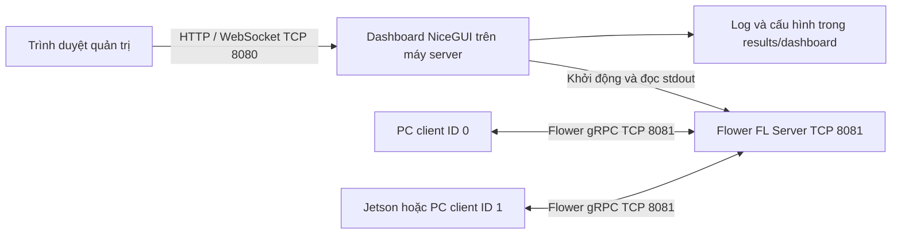

# Hướng dẫn Dashboard FedMedAI: sử dụng, thiết lập server và kết nối client

Tài liệu dành cho người lần đầu triển khai học liên kết (Federated Learning, viết tắt FL) trên một máy hoặc nhiều PC/Jetson trong mạng LAN. Nội dung được đối chiếu với mã nguồn trong dự án ngày **13/11/2026**.

**Mô hình triển khai hiện tại: chỉ máy server chạy dashboard. Các PC/Jetson client chạy tiến trình huấn luyện bằng terminal, không cần cài NiceGUI hoặc khởi động dashboard.** Tab Client Nodes trên server dùng để giám sát số liệu các client gửi về.

Các lệnh bên dưới chạy tại **thư mục gốc dự án**, nơi có `app_nicegui.py`, `requirements.txt`, `server/` và `client/`. Địa chỉ `192.168.1.10` chỉ là ví dụ; hãy thay bằng IPv4 thật của máy server.

## Mục lục

1. [Dashboard làm gì và các máy liên lạc thế nào?](#1-dashboard-làm-gì-và-các-máy-liên-lạc-thế-nào)
2. [Chuẩn bị môi trường](#2-chuẩn-bị-môi-trường)
3. [Khởi động và truy cập dashboard](#3-khởi-động-và-truy-cập-dashboard)
4. [Các thành phần giao diện](#4-các-thành-phần-giao-diện)
5. [Chạy thử trên một máy](#5-chạy-thử-trên-một-máy)
6. [Thiết lập server trong mạng LAN](#6-thiết-lập-server-trong-mạng-lan)
7. [Thiết lập các máy client](#7-thiết-lập-các-máy-client)
8. [Dữ liệu, partition và cấu hình cần đồng bộ](#8-dữ-liệu-partition-và-cấu-hình-cần-đồng-bộ)
9. [Đọc chỉ số và theo dõi tài nguyên](#9-đọc-chỉ-số-và-theo-dõi-tài-nguyên)
10. [Kết quả, nhật ký và vòng đời tiến trình](#10-kết-quả-nhật-ký-và-vòng-đời-tiến-trình)
11. [Khắc phục lỗi thường gặp](#11-khắc-phục-lỗi-thường-gặp)
12. [Cấu trúc mã nguồn và kiểm tra trước khi chạy](#12-cấu-trúc-mã-nguồn-và-kiểm-tra-trước-khi-chạy)

## 1. Dashboard làm gì và các máy liên lạc thế nào?

Dashboard là giao diện web NiceGUI để cấu hình, khởi động, dừng và giám sát các tiến trình FL. Một vòng FL thường gồm: server gửi mô hình/cấu hình → client huấn luyện trên phần dữ liệu được gán → client gửi tham số và chỉ số → server tổng hợp → chuyển sang vòng tiếp theo.



### Phân biệt ba vai trò

| Vai trò | Công việc | Chạy ở đâu? |
| --- | --- | --- |
| Dịch vụ dashboard | Phục vụ trang web, quản lý tiến trình và hiển thị số liệu | Máy chạy `python app_nicegui.py` |
| FL server | Chờ client, điều phối vòng học và tổng hợp mô hình | Tiến trình `server.server`, thường cùng máy dashboard |
| FL client | Đọc dữ liệu, huấn luyện, đánh giá và gửi kết quả | Mỗi PC/Jetson tham gia |

**Mở trang dashboard chưa đồng nghĩa FL server đã chạy.** Cần bấm **Start FL Server** và xem log khởi tạo.

Giao diện hiện tại **không có nút Start Client, Stop selected client hoặc Ping Test**. Client được khởi động/dừng bằng terminal tại máy client, hoặc qua phiên SSH do người vận hành mở. Mở dashboard server bằng trình duyệt trên Jetson chỉ để xem và thao tác với dịch vụ server, không làm Jetson tự trở thành FL client.

| Máy | Cần cài/chạy | Không bắt buộc |
| --- | --- | --- |
| Server | Thư viện huấn luyện, NiceGUI, dashboard và FL server | Trình duyệt trên chính server nếu quản trị từ xa |
| Client PC/Jetson | Mã nguồn tương thích, `requirements-client.txt`, dữ liệu/partition, lệnh `client.client` | NiceGUI, desktop GUI và dịch vụ dashboard |
| Máy quản trị | Trình duyệt truy cập dashboard server | Python hoặc mã nguồn nếu chỉ xem dashboard |

### Phân biệt cổng và địa chỉ

| Giá trị | Ý nghĩa | Cách dùng |
| --- | --- | --- |
| TCP `8080` | Cổng web mặc định của `app_nicegui.py` | Trình duyệt mở `http://192.168.1.10:8080` |
| TCP `8081` | Cổng gRPC mặc định trên biểu mẫu dashboard | Client nhập `192.168.1.10:8081` |
| `0.0.0.0` | Lắng nghe trên mọi giao diện IPv4 của máy | Dùng làm địa chỉ bind của dịch vụ/server |
| `127.0.0.1` | Chính máy đang chạy tiến trình | Dùng khi server và client cùng máy |
| `192.168.1.10` | IPv4 LAN ví dụ của server | Dùng từ máy khác để truy cập/kết nối |

Không dùng `0.0.0.0` làm địa chỉ đích cho client. Hai dịch vụ web và gRPC trên cùng máy phải dùng cổng khác nhau.

> **Lưu ý cấu hình cũ:** `configs/experiment.yaml` hiện đặt gRPC là `8080`, còn biểu mẫu dashboard đặt `8081`. Khi chạy lệnh trực tiếp hoặc dùng YAML, luôn kiểm tra cổng thực tế; không suy ra cổng từ ví dụ cũ.

## 2. Chuẩn bị môi trường

### 2.1. Những thứ cần có trên từng máy

- Python **3.10 trở lên** cho môi trường chạy dashboard của dự án.
- Bản mã nguồn tương thích trên server và mọi client; nên dùng cùng một revision của dự án.
- Trên server: cài thư viện huấn luyện và `requirements-dashboard.txt`. Trên client: dùng `requirements-client.txt`, không cần cài `requirements-dashboard.txt` hoặc các gói giao diện desktop.
- Dung lượng đĩa cho bộ dữ liệu, partition, log và checkpoint; RAM/VRAM đủ cho số client, mô hình và batch size đã chọn.
- Kết nối LAN giữa các máy. Lần tải dữ liệu/thư viện đầu tiên cần Internet hoặc chuẩn bị sẵn tệp tương ứng.

GPU không bắt buộc. Có thể chạy thử bằng CPU. Số lượng client đồng thời càng lớn thì nhu cầu RAM/VRAM càng cao; không có một mức cấu hình tối thiểu chung cho mọi thí nghiệm.

### 2.2. Cài đặt máy server trên Windows PowerShell

```powershell
cd D:\FederatedLearning\FedMed_20K
python --version
python -m venv .venv
.\.venv\Scripts\Activate.ps1
python -m pip install --upgrade pip
python -m pip install -r requirements.txt
python -m pip install -r requirements-dashboard.txt
```

Nếu PowerShell không cho chạy script kích hoạt, có thể gọi Python của môi trường trực tiếp: `.\.venv\Scripts\python.exe -m pip install -r requirements-dashboard.txt`. Các lệnh `python ...` tiếp theo cũng phải dùng đúng Python đó, kể cả lệnh cài `requirements.txt`.

### 2.3. Cài đặt máy server trên Linux/PC

```bash
cd /duong-dan/FedMed_20K
python3 --version
python3 -m venv .venv
source .venv/bin/activate
python -m pip install --upgrade pip
python -m pip install -r requirements.txt
python -m pip install -r requirements-dashboard.txt
```

### 2.4. Lưu ý cho NVIDIA Jetson

Trên Jetson, cần chuẩn bị PyTorch/torchvision tương thích với JetPack, CUDA, kiến trúc ARM và Python đang dùng trước khi cài các phụ thuộc còn lại. Kiểm tra môi trường sẵn có trước khi tạo venv để tránh mất quyền truy cập bản PyTorch đã cài. Không mặc định dùng gói CUDA dành cho PC x86.

```bash
python -c "import torch, torchvision; print('torch:', torch.__version__); print('CUDA:', torch.cuda.is_available()); print('GPU:', torch.cuda.get_device_name(0) if torch.cuda.is_available() else 'CPU')"
```

Jetson đóng vai trò client nên không cần cài NiceGUI hay chạy dashboard. Cần kiểm tra môi trường Python và các thư viện huấn luyện tương thích với mã nguồn hiện tại; cách cài client được trình bày ở mục 7. Xem thêm `configs/jetson.yaml` về hồ sơ phần cứng; CLI cho phép chọn `--device_type pc`, `--device_type jetson_orin` hoặc `--device_type jetson_nano`.

## 3. Khởi động và truy cập dashboard

### 3.1. Trên máy có giao diện đồ họa

```bash
python app_nicegui.py
```

Mở [http://localhost:8080](http://localhost:8080). Mặc định dịch vụ bind `0.0.0.0`, cho phép truy cập từ LAN khi firewall cho phép.

### 3.2. Trên server không có màn hình hoặc chạy qua SSH

```bash
python app_nicegui.py --host 0.0.0.0 --port 8080 --no-browser
```

Từ máy quản trị, mở `http://<IP_SERVER>:8080`. Giữ tiến trình dashboard hoạt động trong suốt phiên thí nghiệm.

### 3.3. Chỉ cho phép truy cập từ chính máy hiện tại

```bash
python app_nicegui.py --host 127.0.0.1 --port 8088 --no-browser
```

`run_nicegui.py` dùng cùng launcher nhưng mặc định `127.0.0.1:8088`. `run_dashboard.py` là launcher **desktop CustomTkinter độc lập**, không phải trang web được mô tả trong tài liệu này.

Dashboard hiện không có đăng nhập/phân quyền. Người truy cập được có thể điều khiển các job trong dịch vụ đó; chỉ triển khai trong mạng tin cậy hoặc qua cơ chế truy cập riêng của hệ thống.

## 4. Các thành phần giao diện

### 4.1. Thanh trên cùng và thẻ tổng quan

- **SERVER · IDLE/RUNNING/...:** trạng thái job server/simulation gần nhất.
- **PORT & NETWORK:** cổng gRPC đang theo dõi, địa chỉ bind, trạng thái `FREE`/`LISTENING` và gợi ý địa chỉ web. Máy có nhiều card mạng/VPN cần tự chọn đúng IPv4 LAN.
- **Monitored run:** chọn job cần xem. Biểu đồ, KPI và bảng node bám theo job được chọn.
- **FL PROGRESS:** vòng hiện tại / tổng vòng của job.
- **BEST TEST ACCURACY:** BTA tốt nhất đã nhận được.
- **GLOBAL LOSS:** test loss gần nhất có dữ liệu và mức thay đổi so với vòng trước.
- Nút biểu tượng tương phản dùng để chuyển nền tối/sáng.

`LISTENING` chỉ cho biết có tiến trình đang nghe cổng, chưa chứng minh đó là đúng FL server hay đã sẵn sàng huấn luyện. Kiểm tra thêm Managed processes và Live Terminal.

Các trình duyệt truy cập cùng dịch vụ dùng chung danh sách tiến trình. Vì vậy thao tác dừng job từ một trình duyệt sẽ tác động đến job mà các trình duyệt khác cũng đang theo dõi; lựa chọn hiển thị và thao tác Clear Console thuộc từng trang.

### 4.2. Tab FL Server

Chọn **LAN Server** để nhận client thật qua mạng hoặc **Local Simulation** để hệ thống tự chạy server và các client mô phỏng trên cùng máy.

| Trường | Ý nghĩa / cách chọn |
| --- | --- |
| Bind IPv4 | `0.0.0.0` cho LAN; `127.0.0.1` cho cùng máy; có thể chọn IPv4 giao diện máy |
| gRPC Port | Cổng Flower, mặc định `8081`; phải khác cổng web và chưa bị chiếm |
| Dataset | `pathmnist`, `bloodmnist`, `organamnist` |
| Model architecture | `Baseline` hoặc `BaselineBN`; tất cả máy phải dùng cùng kiến trúc |
| Aggregation strategy | `FEDAVG`, `FEDPROX`, `FEDNOVA`, `SCAFFOLD`, `FEDBN`, `FEDBNS`, `FEDSLD`, `FEDSOL`, `FEDSWITCH` |
| FedProx μ | Hệ số proximal, xuất hiện khi chọn FedProx |
| Communication rounds | Số vòng FL; giao diện giới hạn từ 1 đến 100 |
| Total clients / partition | Tổng số phần dữ liệu/client ID của partition; không tự tạo máy client trong chế độ LAN |
| Min Fit Clients | Số client tối thiểu tham gia bước huấn luyện |
| Min Available Clients | Số client cần sẵn sàng để server bắt đầu chọn client |
| Fraction Fit | Tỷ lệ chọn từ nhóm client sẵn sàng cho bước fit, trong `(0, 1]`; vẫn chịu ràng buộc Min Fit |
| Non-IID partition | `practical`, `pathological`, `dirichlet_0.1`, `dirichlet_0.3`, `dirichlet_1.0` |
| Local epochs / round | Số epoch client huấn luyện trong mỗi vòng |
| Batch size | Số mẫu mỗi batch của DataLoader; cần cấu hình client phù hợp |
| Learning rate | Tốc độ học ban đầu; lịch LR còn phụ thuộc YAML nền |
| Partition seed | Seed tạo partition và khởi tạo để có thể tái lập |
| Optimizer | `sgd`, `adam`, `adamw` |
| Compute device | `auto`, `cpu`, và các lựa chọn CUDA khi được phát hiện |
| Client local test | Dùng phần test riêng của client theo partition |
| Central test | Bật đánh giá mô hình trên tập test tại server |

Điều kiện bắt buộc: **`1 ≤ Min Fit ≤ Min Available ≤ Total clients`**. Ví dụ có hai client thật thì đặt cả ba giá trị là `2` để chạy đủ cả hai mỗi vòng. `num_clients` là quy mô partition, không phải bộ đếm kết nối đang sống.

Với FedBN/FedBNS, chọn kiến trúc có BatchNorm (`BaselineBN`) để cơ chế giữ BatchNorm cục bộ có ý nghĩa. Mục `scr` có trong controller/CLI nhưng hiện không được đưa vào danh sách chọn strategy trên giao diện.

**Non-IID** nghĩa là phân bố dữ liệu giữa các client không giống nhau. `practical` chia dữ liệu mô phỏng lệch phân bố thực tế; `pathological` giới hạn tập lớp ở từng client; `dirichlet_*` chia theo phân bố Dirichlet, với alpha nhỏ thường tạo mức lệch nhãn mạnh hơn. Seed giúp tái lập cách chia. **Round** là một vòng trao đổi server–client, còn **epoch** là một lượt học qua dữ liệu train cục bộ; 2 round × 1 local epoch không đồng nghĩa mỗi máy đã học toàn bộ dữ liệu của federation.

Các nút và vùng theo dõi:

- **Start FL Server:** tạo job server hoặc simulation theo chế độ đang chọn.
- **Stop Server:** dừng job server/simulation do dịch vụ dashboard này quản lý.
- **Export server YAML:** tải cấu hình đã chuẩn hóa của biểu mẫu hiện tại; chưa khởi động huấn luyện.
- **Execution monitor:** vai trò, trạng thái, thời gian chạy, thư mục kết quả và exit code của job được theo dõi.
- **Managed processes:** danh sách job với Role, Run ID, PID, Status, Exit.

### 4.3. Tab Client Nodes

Tab này **chỉ giám sát client**, không cài đặt hoặc khởi động client. Chọn job server trong **Monitored run** để xem đúng federation.

Bốn thẻ tổng quan:

| Thẻ | Ý nghĩa thực tế |
| --- | --- |
| CONFIGURED CLIENTS | Tổng client trong cấu hình partition của job |
| CLIENTS OBSERVED | Số client ID đã có báo cáo trong job, không phải số kết nối đang online |
| FIT REPORTS THIS ROUND | Số client có báo cáo fit chứa train loss ở vòng hiện tại |
| AWAITING FIT REPORT | Tổng client cấu hình trừ số báo cáo fit vòng hiện tại, chặn dưới tại 0 |

Nếu Fraction Fit nhỏ hơn 1, một số client có thể không được chọn huấn luyện vòng đó; AWAITING FIT REPORT không đồng nghĩa có bấy nhiêu client lỗi hoặc mất kết nối.

**Federation nodes** hiển thị ID, IPv4, loại thiết bị, trạng thái báo cáo, round, số mẫu train, thời gian fit, ping, CPU/RAM, VRAM, train/test accuracy và train loss. Dùng **Search nodes** để lọc bảng.

**Inspect client** cho phép chọn một client đã báo cáo để xem:

- Vòng báo cáo mới nhất và thời điểm server nhận báo cáo.
- Số mẫu train/test, số epoch hoàn thành và learning rate.
- Thời gian fit, thời gian epoch trung bình, kích thước payload mô hình và RAM hệ thống đã dùng.
- Biểu đồ train/test accuracy, train/test loss và lịch sử theo round.

**Export client history** tải CSV lịch sử mà server đã nhận của client đang chọn. Đây là lịch sử báo cáo theo round, không phải toàn bộ CSV theo epoch hoặc terminal log trên máy client. Bảng lịch sử dùng accuracy trong `[0,1]`; biểu đồ chuyển sang phần trăm.

Client cần dùng mã nguồn đã cập nhật để gửi các trường chi tiết này. Trường chưa được gửi hoặc chưa có kết quả đánh giá giữ dấu `—`/ô trống. Client ID phải duy nhất trong federation và thuộc `0..Total clients - 1`; người vận hành phải kiểm tra ID trên mọi máy.

Báo cáo được chuyển qua Flower rồi server phát sự kiện cho dashboard; client chạy CLI không cần NiceGUI hoặc bật chế độ dashboard để server nhận số liệu. Telemetry không phải heartbeat liên tục và log terminal đầy đủ của client không được thu về server.

### 4.4. Tab Live Analytics

Biểu đồ hiển thị accuracy Train/Test/BTA/MCTA/BMCTA, loss Train/Test và bảng số liệu theo round của job server/simulation đang chọn. Để xem riêng một client, vào **Client Nodes → Inspect client** trong cùng job.

Ô trống hoặc dấu `—` nghĩa là chưa có hoặc không có số liệu tương ứng. Không diễn giải thành giá trị 0. Giao diện cập nhật khoảng 0,7 giây nhưng dữ liệu mới vẫn phụ thuộc thời điểm job gửi báo cáo.

### 4.5. Tab Live Terminal

Chọn nguồn **Selected run** hoặc **All processes**; lọc theo `INFO`, `WARNING`, `ERROR`, `METRIC` và từ khóa.

Live Terminal hiển thị log của tiến trình server/simulation do dashboard quản lý. Terminal log đầy đủ của client từ xa vẫn nằm tại máy client; muốn đọc từ xa, dùng SSH hoặc thu gom tệp log.

**Clear Console** chỉ xóa phần hiển thị trong tab trình duyệt hiện tại; không xóa tệp log. **Copy Logs** sao chép các dòng đang hiển thị. Bộ đệm dùng chung giữ tối đa 4.000 dòng; phần hiển thị giữ tối đa 2.000 dòng. Muốn xem log đầy đủ hãy mở `console.log` của job.

### 4.6. Tab Cluster & Data

**Host telemetry** lấy CPU/RAM/GPU/nhiệt độ của **máy chạy dịch vụ dashboard**, chu kỳ khoảng 3 giây. Đây không phải tổng tài nguyên tất cả máy trong cụm.

**Non-IID data distribution** đọc các tệp `data/partitions/*.json` đang tồn tại trên máy dashboard. Bấm **Scan partitions**, chọn tệp để xem số mẫu mỗi lớp của từng client. Quét partition không tự tải dataset hoặc sinh partition mới.

## 5. Chạy thử trên một máy

### 5.1. Cách nhanh: Local Simulation

1. Cài môi trường và chạy dashboard.
2. Trong FL Server chọn **Local Simulation**.
3. Chọn `pathmnist`, `Baseline`, `fedavg`, partition `practical`, `Total clients = 2`, `rounds = 2`, `local_epochs = 1`, batch size `16`, LR `0.01`, seed `42`, bật Client local test và tắt Central test.
4. Chọn CPU nếu muốn kiểm tra luồng chạy trước khi dùng GPU.
5. Bấm **Start FL Server**, chọn job simulation ở Monitored run rồi xem Live Terminal.
6. Chờ tải dữ liệu/tạo partition nếu còn thiếu; theo dõi Live Analytics khi có round đầu tiên.

Simulation tự chọn cổng khả dụng và dùng **mọi client mỗi vòng**. Các trường bind/cổng, Min Fit, Min Available, Fraction Fit bị vô hiệu hóa cho chế độ này. Simulation phải chạy riêng, không đồng thời với job server/client khác do cùng dịch vụ dashboard quản lý.

### 5.2. Kiểm tra luồng LAN ngay trên một máy

1. Chọn **LAN Server**, bind `127.0.0.1`, gRPC `8081`, tổng client/Min Fit/Min Available đều `2`; đặt các thông số dữ liệu và huấn luyện giống ví dụ 5.1.
2. Bấm **Export server YAML**, lưu tệp tại `configs/client_dashboard.yaml` trong dự án.
3. Bấm **Start FL Server**, chờ log xác nhận server đã khởi tạo.
4. Mở hai terminal riêng, vào thư mục gốc và kích hoạt môi trường Python; chạy lần lượt các lệnh bên dưới.
5. Chọn job server ở Monitored run; vào Client Nodes xem báo cáo và Inspect client xem từng client.

Terminal thứ nhất:

```bash
python -m client.client --config configs/client_dashboard.yaml --client_id 0 --server_address 127.0.0.1:8081
```

Terminal thứ hai:

```bash
python -m client.client --config configs/client_dashboard.yaml --client_id 1 --server_address 127.0.0.1:8081
```

Cả ba tiến trình ở cùng máy, nhưng client vẫn được chạy bằng terminal. Sau khi thử xong, kiểm tra/dừng hai client bằng Ctrl+C tại từng terminal trước khi chạy simulation để giải phóng tài nguyên.

## 6. Thiết lập server trong mạng LAN

### 6.1. Ví dụ mô hình triển khai

| Máy | IPv4 ví dụ | Vai trò |
| --- | --- | --- |
| Máy A | `192.168.1.10` | Dashboard web `8080` và FL server `8081` |
| Máy B | `192.168.1.11` | Client ID `0` |
| Máy C | `192.168.1.12` | Client ID `1` |

Trên Windows dùng `ipconfig`; trên Linux dùng `hostname -I` để xem địa chỉ. Chọn địa chỉ thuộc mạng mà các client truy cập được. Nên cố định IP hoặc đặt DHCP reservation để địa chỉ server không đổi giữa phiên.

### 6.2. Mở cổng cần dùng

Client cần kết nối đến TCP `8081` của máy A. Chỉ cần mở TCP `8080` cho các máy muốn xem dashboard từ xa. Máy client thường không cần mở cổng nghe gRPC inbound vì chủ động kết nối đến server.

Ví dụ Windows PowerShell **chạy bằng quyền Administrator trên máy A**, dùng khi mạng thực tế được đặt profile Private:

```powershell
New-NetFirewallRule -DisplayName "FedMedAI Web LAN" -Direction Inbound -Protocol TCP -LocalPort 8080 -RemoteAddress LocalSubnet -Profile Private -Action Allow
New-NetFirewallRule -DisplayName "FedMedAI Flower LAN" -Direction Inbound -Protocol TCP -LocalPort 8081 -RemoteAddress LocalSubnet -Profile Private -Action Allow
```

Ví dụ Ubuntu **nếu đang dùng UFW** và subnet thực tế là `192.168.1.0/24`:

```bash
sudo ufw allow from 192.168.1.0/24 to any port 8080 proto tcp
sudo ufw allow from 192.168.1.0/24 to any port 8081 proto tcp
```

Thay subnet/cổng theo mạng của bạn; không cần tắt toàn bộ firewall. Wi-Fi có chế độ cô lập thiết bị hoặc các máy khác VLAN có thể vẫn không kết nối được dù cùng truy cập Internet.

### 6.3. Khởi động FL server

1. Trên máy A chạy `python app_nicegui.py --host 0.0.0.0 --port 8080 --no-browser`.
2. Mở dashboard, chọn LAN Server, bind `0.0.0.0`, gRPC `8081`.
3. Dùng cấu hình thử: `pathmnist`, `Baseline`, `fedavg`, `practical`, tổng client `2`, Min Fit `2`, Min Available `2`, Fraction Fit `1`, rounds `2`, local epochs `1`, batch `16`, LR `0.01`, seed `42`, local test bật, central test tắt.
4. Bấm **Export server YAML**, tải tệp `fedmedai-config.yaml`; chép tệp đó đến từng client và lưu thành `configs/client_dashboard.yaml`. Nếu thay cấu hình sau đó, xuất và chép lại để các máy dùng đúng phiên bản.
5. Bấm **Start FL Server**. Trong Live Terminal xác nhận tiến trình khởi tạo và nghe `0.0.0.0:8081`.
6. Chuyển sang khởi động máy B và C. Server chờ đủ client là bình thường khi đặt Min Available `2`.

Không thay đổi biểu mẫu rồi xuất cấu hình khác cho client khi server đang chạy. Job đang chạy giữ cấu hình đã chụp tại thời điểm Start; chỉnh biểu mẫu không cập nhật ngược vào job đó.

## 7. Thiết lập các máy client

### 7.1. Cài môi trường client trên mỗi PC/Jetson

Máy B/C cần mã nguồn tương thích với server và thư viện huấn luyện; **không cài hoặc khởi động dashboard trên client**. Tệp `requirements-client.txt` tách riêng phụ thuộc client, không chứa NiceGUI hay CustomTkinter.

Windows PowerShell:

```powershell
cd D:\FederatedLearning\FedMed_20K
python -m venv .venv
.\.venv\Scripts\Activate.ps1
python -m pip install --upgrade pip
python -m pip install -r requirements-client.txt
```

Linux/PC:

```bash
cd /duong-dan/FedMed_20K
python3 -m venv .venv
source .venv/bin/activate
python -m pip install --upgrade pip
python -m pip install -r requirements-client.txt
```

Với Jetson, áp dụng lưu ý PyTorch/JetPack ở mục 2.4 trước khi cài phụ thuộc, tránh thay bản PyTorch tương thích bằng gói không phù hợp.

Chép YAML đã xuất từ server thành `configs/client_dashboard.yaml` trên máy B/C, chuẩn bị dữ liệu/partition theo mục 8 và gán ID duy nhất cho mỗi máy. Dashboard chưa có chức năng tự chép YAML, phân phối dữ liệu hoặc cài phần mềm lên client.

### 7.2. Khởi động, theo dõi và dừng client

Trên máy B chạy:

```bash
python -m client.client --config configs/client_dashboard.yaml --client_id 0 --server_address 192.168.1.10:8081
```

Trên máy C chạy:

```bash
python -m client.client --config configs/client_dashboard.yaml --client_id 1 --server_address 192.168.1.10:8081
```

Các lệnh giống nhau trên Windows/Linux sau khi vào đúng thư mục và kích hoạt môi trường. Với nhiều máy hơn, tiếp tục gán ID `2`, `3`, ... trong phạm vi partition và cập nhật số client trên server.

**Luôn truyền `--server_address` đúng IP LAN và cổng gRPC của server.** YAML xuất ra có thể chứa địa chỉ bind `0.0.0.0` hoặc địa chỉ cục bộ; cờ CLI ở trên ghi đè địa chỉ đích. Chỉ dùng `127.0.0.1` nếu client thực sự chạy cùng máy với FL server.

Đối với hồ sơ phần cứng, có thể thêm `--device_type pc`, `--device_type jetson_orin` hoặc `--device_type jetson_nano`. Kiểm tra cả trường `device_type` trong YAML được sao chép để không vô tình dùng hồ sơ PC trên Jetson.

CLI client không có cờ `--device`; chọn/ẩn GPU qua biến môi trường `CUDA_VISIBLE_DEVICES` của chính máy client nếu cần. Compute device trên dashboard server chỉ áp dụng cho tiến trình server/simulation mà nó khởi chạy, không điều khiển GPU trên máy từ xa.

Khi client chạy, xem log tại terminal của máy đó. Trên dashboard server, chọn job server → Client Nodes → Inspect client để xem các báo cáo nhận được sau vòng học. **Không cần chạy thêm dashboard trên máy B/C.**

Dừng client bằng **Ctrl+C tại terminal của máy client**. Có thể dùng SSH để vận hành terminal từ xa nếu đã thiết lập SSH. Stop Server trên dashboard không phải lệnh dừng từ xa mọi client; sau khi server dừng, kiểm tra các terminal client và dừng những tiến trình còn chạy.

Dashboard hiện có nút xuất server YAML nhưng không có giao diện nhập YAML. Thông tin thiết lập client được hướng dẫn trong tài liệu, còn tab Client Nodes dành cho giám sát.

### 7.3. Kiểm tra kết nối trước khi huấn luyện

Chạy từ máy B/C trên Windows:

```powershell
Test-NetConnection 192.168.1.10 -Port 8081
```

Hoặc dùng Python trên Windows/Linux:

```bash
python -c "import socket; s=socket.create_connection(('192.168.1.10',8081),timeout=3); print('TCP OK'); s.close()"
```

`TCP OK`/`TcpTestSucceeded: True` xác nhận đường TCP hoạt động tại thời điểm thử. Sau đó vẫn phải kiểm tra log client kết nối Flower và server thực sự bắt đầu round. Thực hiện phép thử từ từng máy client; việc trình duyệt mở được cổng web trên máy A không chứng minh đường gRPC từ máy B/C đã thông.

## 8. Dữ liệu, partition và cấu hình cần đồng bộ

### 8.1. Cách dự án dùng MedMNIST

Trong triển khai hiện tại, mỗi client nạp bộ MedMNIST cục bộ rồi lấy các chỉ số mẫu được gán trong partition JSON. Nếu thiếu dữ liệu, mã client có thể tải dữ liệu với `download=True`; nếu thiếu partition, client thử tự sinh partition theo dataset/mode/seed/số client/local test.

Đây là cách mô phỏng phân tán bộ dữ liệu chuẩn: tệp dataset trên máy client có thể chứa toàn bộ bộ dữ liệu, dù client chỉ huấn luyện trên phần chỉ số của mình. Dashboard không tự chuyển dữ liệu ảnh, không đồng bộ thư mục giữa máy và chưa cung cấp giao diện gắn bộ dữ liệu bệnh viện tùy ý. Muốn dùng dữ liệu riêng cần bổ sung phần nạp dữ liệu và quy tắc chia tập.

### 8.2. Tạo partition trước khi chạy

Ví dụ khớp cấu hình hai client ở trên:

```bash
python -m experiments.run_partition --dataset pathmnist --partition_mode practical --num_clients 2 --seed 42 --local_test
```

Tệp dự kiến: `data/partitions/partition_pathmnist_practical_localtest_seed42_clients2.json`. Chép **cùng tệp JSON này** đến vị trí tương ứng trên các client; đồng thời chuẩn bị cùng phiên bản/thứ tự dữ liệu. JSON chỉ chứa ánh xạ và thống kê, không thay thế các tệp dataset.

Nếu muốn chỉ rõ partition khi chạy CLI:

```bash
python -m client.client --config configs/client_dashboard.yaml --client_id 0 --server_address 192.168.1.10:8081 --partition_path data/partitions/partition_pathmnist_practical_localtest_seed42_clients2.json
```

Để xem biểu đồ phân bố trên máy A, chép JSON về `data/partitions/` của máy A rồi bấm Scan partitions. Server chỉ cần dữ liệu test tại máy mình khi bật central evaluation; luồng khởi tạo từng strategy có thể còn cần metadata, vì vậy hãy đọc log nếu có yêu cầu dữ liệu bổ sung.

### 8.3. Những tham số cần đối chiếu

| Nhóm | Cần thống nhất / kiểm tra |
| --- | --- |
| Mô hình | Dataset, số lớp và kiến trúc model |
| Chia dữ liệu | Partition JSON, `partition_mode`, `num_clients`, `seed`, `local_test` |
| Định danh | Client ID duy nhất và có trong partition |
| Thuật toán | Strategy và các tham số riêng của strategy |
| Huấn luyện | Local epochs, optimizer, LR/lịch LR, augmentation, momentum, weight decay |
| Theo máy | Server address phải trỏ đúng máy A; batch size/thiết bị cần phù hợp tài nguyên máy client |

Server gửi một số cấu hình xuống mỗi round, gồm strategy, local epochs, optimizer và thông tin LR. Client có thể dùng giá trị server gửi thay cho giá trị khởi tạo. **Không phải mọi trường đều được truyền tự động:** model, dataset, partition, batch size và augmentation phải chuẩn bị đúng tại client. Cách chắc chắn nhất cho thử nghiệm đồng nhất là dùng cùng YAML đã xuất và cùng partition.

### 8.4. Cấu hình nâng cao

Job LAN server kế thừa `configs/experiment.yaml`; job simulation kế thừa `configs/simulation.yaml`. Dashboard ghi đè các trường có trên biểu mẫu, rồi tạo YAML đầy đủ cho mỗi job. Client CLI đọc tệp truyền qua `--config`, ví dụ `configs/client_dashboard.yaml`, và các cờ CLI được dùng để ghi đè giá trị tương ứng.

Các thiết lập như `lr_mode`, `momentum`, `weight_decay`, augmentation, `num_workers`, early stopping và tham số FedSOL/FedSwitch phần lớn nằm trong YAML nền. Muốn thay đổi chúng, sửa đúng tệp nền trước khi tạo job và đồng bộ giữa các máy. Tệp `config.yaml` trong thư mục job là căn cứ để biết **lần chạy đó thực sự đã dùng cấu hình nào**.

Export server YAML đọc biểu mẫu hiện tại, không tự lấy lại cấu hình của job đang chọn. Muốn tái lập job cũ, dùng chính `config.yaml` đã lưu của job đó và kiểm tra lại đường dẫn/cổng.

## 9. Đọc chỉ số và theo dõi tài nguyên

### 9.1. Các chỉ số học máy

| Chỉ số | Cách hiểu trong hệ thống |
| --- | --- |
| Train accuracy/loss | Live Analytics hiển thị tổng hợp fit của federation; Inspect client hiển thị báo cáo riêng của client đã chọn |
| Test accuracy/loss | Kết quả đánh giá mà job phát ra; khi đánh giá phân tán, accuracy thường được tổng hợp theo số mẫu test |
| MCTA | Mean Client Test Accuracy: trung bình accuracy các client có mẫu test và đã trả kết quả ở vòng đó; mỗi client có trọng số bằng nhau |
| BMCTA | Giá trị MCTA cao nhất tính đến vòng hiện tại |
| BTA | Best Test Accuracy: giá trị test accuracy tốt nhất được recorder ghi nhận; trong luồng đánh giá client là accuracy có trọng số theo số mẫu tốt nhất |
| Clients | Số client có báo cáo tương ứng trong bản ghi round; không phải phép đếm online liên tục |

Ví dụ: client 0 đúng `90/100` mẫu, client 1 đúng `50/1000` mẫu. MCTA là `(90% + 5%)/2 = 47,5%`, còn accuracy theo số mẫu là `140/1100 ≈ 12,73%`. Vì vậy BMCTA và BTA có thể khác nhau đáng kể.

Khi bật central test, xem thêm nguồn đánh giá trong log và tệp kết quả: có cả đánh giá tập trung và đánh giá client. Không mặc định mọi đường Test/BTA đều biểu diễn cùng một tập test. Giá trị accuracy thô trong bảng/JSON/CSV thường nằm trong `[0,1]`, còn đồ thị và KPI chuyển sang phần trăm; ví dụ `0.85` tương ứng `85%`.

Client không có mẫu test có thể bị bỏ qua trong phép tính trung bình phù hợp. Chưa có báo cáo round đầu tiên thì bảng node/biểu đồ có thể vẫn trống.

### 9.2. Telemetry của node

- CPU/RAM là thông tin tài nguyên trên máy client tại thời điểm lấy mẫu.
- VRAM trong bảng node là bộ nhớ GPU do **tiến trình PyTorch client** cấp phát; không phải toàn bộ bộ nhớ GPU của máy.
- VRAM ở Host telemetry là thông tin toàn thiết bị khi cảm biến cung cấp được.
- GPU trên host lấy từ NVIDIA SMI hoặc cảm biến Jetson; có thể nhận diện CUDA qua PyTorch nhưng không đọc được utilization/nhiệt độ.
- Dấu `—` thể hiện cảm biến hoặc trường dữ liệu chưa có; trên Jetson bộ nhớ GPU dùng chung với RAM nên cần đọc kèm RAM hệ thống.

Node gửi telemetry theo vòng học, không có heartbeat online liên tục. `Reported` nghĩa là có báo cáo gần đây; sau khoảng 60 giây chưa có báo cáo mới giao diện hiển thị `Awaiting new report`. Client đang học một vòng dài cũng có thể ở trạng thái này, nên chưa thể kết luận mất kết nối. `Run ended` phản ánh job theo dõi đã kết thúc.

## 10. Kết quả, nhật ký và vòng đời tiến trình

### 10.1. Thư mục kết quả

```text
results/
├── dashboard/
│   └── <server|simulation>-<thoi-gian>-<ma>/
│       ├── config.yaml       # Cấu hình đã dùng cho job
│       ├── console.log       # Stdout/stderr của tiến trình do dashboard khởi chạy
│       ├── summary.json      # Tóm tắt trạng thái, round và node khi job kết thúc
│       └── artifacts/        # Đầu ra huấn luyện của server/simulation
└── clients/
    └── client_<id>/           # Đầu ra client mặc định, nằm trên máy chạy client
```

Đầu ra server có thể gồm `fl_results.json`, CSV, đồ thị và checkpoint `best_model.pth`/`final_model.pth` tùy quá trình chạy và trạng thái mô hình. Simulation có thể tạo thêm thư mục con và báo cáo so sánh bên trong artifacts. Xem đường dẫn cụ thể được in trong console.log.

Client có thể lưu `client_<id>_round_metrics.csv`, `client_<id>_epoch_metrics.csv`, `client_<id>_eval_metrics.csv`, biểu đồ, ping log và checkpoint trong `results/clients/client_<id>/` trên chính máy client. Các tệp này không tự chuyển về `results/dashboard/` của server.

Nút **Export client history** trên server chỉ xuất những bản ghi theo round đã nhận và giữ trong phiên dashboard; không thay thế việc sao lưu toàn bộ kết quả trên client.

Để tránh ghi đè đầu ra client giữa các lần chạy CLI, dùng thư mục riêng:

```bash
python -m client.client --config configs/client_dashboard.yaml --client_id 0 --server_address 192.168.1.10:8081 --client_dir results/clients/lan_demo_01/client_0
```

Khi kết thúc thí nghiệm nhiều máy, thu gom log/CSV/checkpoint từ từng client nếu cần phân tích đầy đủ. Dashboard server không tự tải các tệp này về. Lưu cùng YAML, partition và revision mã nguồn để tái lập.

### 10.2. Trạng thái và thao tác dừng

| Trạng thái | Ý nghĩa |
| --- | --- |
| `starting` | Chuẩn bị khởi tạo tiến trình |
| `running` | Tiến trình đang chạy; có thể vẫn đang tải dữ liệu/chờ client |
| `stopping` | Đã gửi yêu cầu dừng |
| `completed` | Tiến trình kết thúc với exit code 0 |
| `stopped` | Job kết thúc sau yêu cầu dừng |
| `failed` | Tiến trình lỗi hoặc đọc luồng log gặp lỗi |

`completed` cần đối chiếu thêm số vòng và log; exit code 0 không tự bảo đảm thí nghiệm đã đạt đủ mục tiêu.

Đóng tab trình duyệt **không dừng job**. Tắt dịch vụ dashboard sẽ yêu cầu dừng các tiến trình mà nó quản lý, kể cả tiến trình con. Cơ chế dừng gửi Ctrl+C/CTRL_BREAK trước, chờ khoảng 6 giây rồi có thể cưỡng chế kết thúc; dừng cưỡng chế có thể làm thiếu đầu ra cuối phiên.

Stop Server chỉ quản lý tiến trình server/simulation trong dịch vụ đó. Client chạy CLI trên các máy khác cần được kiểm tra và dừng tại terminal tương ứng bằng Ctrl+C. Sau khi khởi động lại dashboard, danh sách job cũ không tự khôi phục/reattach; các tệp kết quả đã lưu vẫn còn trên đĩa. Dashboard không có chức năng tự tiếp tục huấn luyện từ checkpoint bằng một nút bấm.

## 11. Khắc phục lỗi thường gặp

| Hiện tượng | Kiểm tra và xử lý |
| --- | --- |
| Không mở được web từ máy khác | Dịch vụ dashboard có chạy không, có bind `0.0.0.0` không, đúng IP/cổng web không, firewall và VLAN có cho qua không |
| Web mở được nhưng client không kết nối | Web và gRPC là hai cổng riêng; kiểm tra FL server đã Start, bind đúng và mở TCP `8081` |
| Client trỏ `127.0.0.1` trên máy B | Đổi sang IPv4 của máy A, ví dụ `192.168.1.10:8081` |
| `gRPC port is busy` / lỗi bind | Kiểm tra tiến trình chiếm cổng; dừng đúng tiến trình nếu không cần, hoặc đổi gRPC và cập nhật target trên mọi client |
| Server chờ mãi | Chưa đủ Min Available, client đang tải dữ liệu hoặc đã lỗi; kiểm tra log trên từng máy và số client thực tế |
| Báo `Min Fit ≤ Min Available ≤ Total clients` | Sửa cả ba trường trên biểu mẫu FL Server đúng quan hệ trước khi Start/Export |
| Client ID không hợp lệ/partition thiếu client | ID phải trong `0..N-1`; kiểm tra đúng JSON và `num_clients` |
| Trùng client ID | Kiểm tra lệnh trên từng máy, dừng tiến trình cũ và gán ID duy nhất; không dựa vào bảng node để phát hiện mọi trường hợp trùng |
| Lỗi shape/state_dict/BatchNorm | Đồng bộ model, dataset/số lớp, phiên bản mã nguồn và cấu hình strategy |
| Không tìm thấy/tạo được partition | Kiểm tra thư mục chạy, quyền ghi, tên partition, dữ liệu và kết nối tải; có thể tạo trước rồi chép JSON giống nhau |
| CUDA out of memory | Giảm batch size **trên client bị lỗi**, giảm số client cùng GPU hoặc chọn CPU cho thử nghiệm |
| Jetson không thấy CUDA | Kiểm tra PyTorch/torchvision, JetPack, môi trường Python và CUDA_VISIBLE_DEVICES trên chính Jetson; Compute device ở server không thay đổi GPU client |
| Biểu đồ/node trống | Chọn đúng Monitored run; chờ vòng đầu hoàn tất; xem log có lỗi trước khi phát metrics không |
| Node hiện Awaiting new report | Vòng học có thể kéo dài hơn 60 giây; đối chiếu terminal client và hoạt động CPU/GPU trước khi kết luận mất kết nối |
| Thiếu thư viện dù đã cài | Server dùng môi trường khởi chạy dashboard; client dùng môi trường terminal của máy client. Kiểm tra đúng venv/interpreter trên máy báo lỗi |
| Simulation không cho Start | Dừng job server/simulation đang hoạt động trong cùng dịch vụ dashboard; dừng thêm client CLI nếu cần giải phóng tài nguyên |
| Không thấy nút Start Client/Ping Test | Giao diện hiện tại chỉ giám sát client; chạy lệnh client và kiểm tra TCP trong terminal theo mục 7 |
| Inspect client thiếu chỉ số | Cập nhật mã nguồn client/server tương thích và chờ báo cáo fit/evaluation; trường chưa gửi sẽ trống |
| Mất log cũ trên màn hình | Mở console.log; màn hình và bộ đệm chỉ giữ số dòng hữu hạn |
| Không thấy các job sau khi restart | Dashboard không nạp lại lịch sử job; đọc `results/dashboard/` trực tiếp |

Kiểm tra tiến trình nghe cổng trên Windows:

```powershell
Get-NetTCPConnection -LocalPort 8081 -State Listen
```

Trên Linux:

```bash
ss -ltnp
```

Nếu cần gửi thông tin để chẩn đoán, lấy cấu hình của job, phần cuối console.log, lệnh client, Python/PyTorch version và sơ đồ IP/cổng thực tế.

## 12. Cấu trúc mã nguồn và kiểm tra trước khi chạy

### 12.1. Tệp liên quan

| Tệp/thư mục | Vai trò |
| --- | --- |
| `app_nicegui.py` | Launcher web trên server, xử lý host/port/no-browser |
| `requirements-client.txt` | Phụ thuộc huấn luyện cho client không giao diện |
| `requirements-dashboard.txt` | Phụ thuộc web dashboard, cài trên server |
| `run_nicegui.py` | Launcher tương thích mặc định localhost:8088 |
| `dashboard/app.py` | Trang NiceGUI, biểu mẫu, bảng, biểu đồ và thao tác người dùng |
| `dashboard/controller.py` | Kiểm tra cấu hình, chạy/dừng subprocess, ghi log và summary |
| `dashboard/metrics.py` | Đọc sự kiện `[METRIC]` và log để tạo dữ liệu round/node |
| `dashboard/system.py` | IP LAN, thử TCP, kiểm tra cổng, tài nguyên host và đọc partition |
| `monitoring/stream.py` | Phát sự kiện stdout có cấu trúc khi chạy ở chế độ dashboard |
| `server/server.py` | Điểm vào FL server Flower |
| `client/client.py` | Điểm vào client huấn luyện/đánh giá |
| `experiments/run_simulation.py` | Điều phối simulation cục bộ |
| `experiments/run_partition.py` | Sinh partition và biểu đồ phân bố |
| `configs/experiment.yaml` | Cấu hình nền cho server/client |
| `configs/simulation.yaml` | Cấu hình nền cho simulation |
| `configs/jetson.yaml` | Hồ sơ phần cứng và ánh xạ thiết bị |
| `tests/test_dashboard*.py` | Kiểm tra logic dashboard và tích hợp strategy |

### 12.2. Danh sách đối chiếu trước khi bấm Start

- [ ] Server và client chạy đúng môi trường Python, cùng mã nguồn tương thích.
- [ ] Đã phân biệt cổng web và gRPC; cổng gRPC chưa bị tiến trình khác chiếm.
- [ ] Client truy cập được IP LAN/cổng gRPC của server từ chính máy client.
- [ ] Dataset/model/strategy/partition/seed/local test và tổng client đã thống nhất.
- [ ] Client ID duy nhất, nằm trong partition, số máy chạy đủ Min Available.
- [ ] Batch size và số tiến trình phù hợp RAM/VRAM của từng máy.
- [ ] Đã lưu YAML/partition và có thư mục đầu ra phù hợp cho thí nghiệm.
- [ ] Đã chọn đúng Monitored run để xem log, node và số liệu.

Nếu cần kiểm tra phần mềm dashboard sau khi chỉnh mã:

```bash
python -m unittest discover -s tests -p "test_dashboard*.py" -v
```

Bộ kiểm tra này xác minh cấu hình, sự kiện metrics, partition, thử TCP, quản lý nhiều tiến trình, dừng tiến trình con và tệp kết quả; không thay thế một lần huấn luyện MedMNIST thực tế trên các máy trong LAN.
