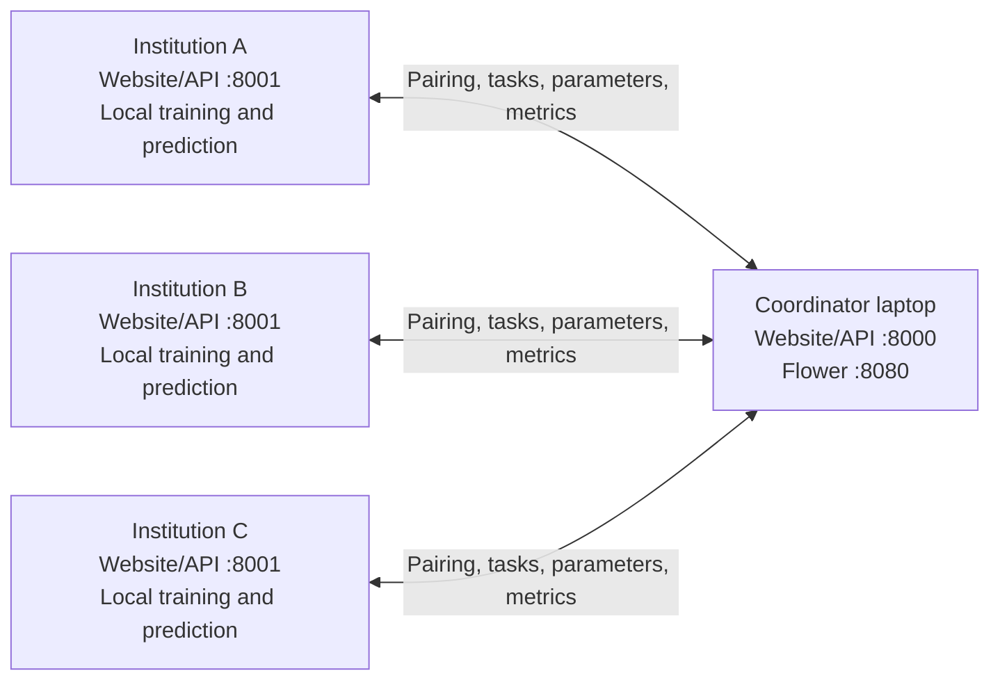

# FedMedAI: teammate setup from Git to a complete LAN demo

Use this guide for the **Windows laptop pilot**: one coordinator laptop and three institution laptops. Each teammate runs the Institution service on their own computer. Add Jetsons only after the laptop workflow succeeds and their environments pass the compatibility gate in section 15.

The commands below use **PowerShell**, not Git Bash, and run from the repository root containing `client`, `server`, `portal`, and `web`.

## 0. Maintainer: publish the application before teammates pull

A teammate can pull only committed and pushed files. The portal implementation and this guide must be included on the branch your team shares.

Review and stage the application files explicitly:

```powershell
git status --short
git add .gitignore README.md portal web scripts/setup_portal.ps1 scripts/start_portal.ps1 scripts/start_portal.sh utils/portal_events.py client/client.py server/server.py datasets/medmnist_code.py monitoring/metrics.py
git diff --cached --name-status
```

Check the staged list before committing. Keep unrelated research-result deletions or other work out of this commit. After that review:

```powershell
git commit -m "Add FedMedAI LAN portals and team setup guide"
git push -u origin HEAD
git rev-parse --short HEAD
```

Share the **branch name and commit hash** with the team. If a push is rejected because the remote branch has moved, inspect the divergence before proceeding; do not force-push over a teammate's work.

Git normally supplies the application source. These local assets need their own preparation:

| Item | After a fresh clone |
|---|---|
| `portal/`, `web/src/`, launcher scripts | Available after the application commit is pushed and pulled |
| `.venv-train/`, `.venv-web/` | Create separately on every computer |
| `web/dist/` | Build locally, or copy a build made from the same commit |
| MedMNIST `.npz` files | Prepare/download on each computer, or copy the same public benchmark files |
| Trained `.pth` checkpoints | Share separately if needed; ignored checkpoints are not uploaded by a normal commit |
| `.portal-coordinator/`, `.portal-institution/` | Created on first launch; contain that device's account, identity, pairing credentials, and history |

Do not copy another device's portal state or virtual environment. Python virtual environments are intended to be recreated at their destination. [Python venv documentation](https://docs.python.org/3/library/venv.html)

## 1. Decide who runs each role

Example addresses below are placeholders; replace them with your actual LAN IPv4 addresses.

| Computer | Role | Example IP | Local browser URL |
|---|---|---|---|
| Your/server laptop | Coordinator | `192.168.1.10` | `http://127.0.0.1:8000` |
| Teammate A | Institution A | `192.168.1.11` | `http://127.0.0.1:8001` |
| Teammate B | Institution B | `192.168.1.12` | `http://127.0.0.1:8001` |
| Teammate C | Institution C | `192.168.1.13` | `http://127.0.0.1:8001` |

Each client can use port **8001**, because it runs on a different computer. The coordinator also uses **8080** for Flower while a training session is running.

The server laptop is the coordinator; it is not automatically an additional training client. Selecting A, B, and C creates a three-client partition. Each institution starts one real `client.client` worker automatically when the coordinator starts training.



`127.0.0.1` always means the computer where the browser or command is running. On a client, the coordinator connection URL must use the **server's LAN IP**, such as `http://192.168.1.10:8000`.

## 2. Everyone: install tools and get the same code

Install Git, a 64-bit Python, and Node.js with npm. Use a current Python 3.14 maintenance release for these examples; the local verification used Python 3.14.7. The web service requires Python 3.11+. An existing compatible training environment can be retained.

For frontend builds, use Node.js **24 LTS** (the locally tested major version) or a compatible newer release; the project requires at least Node 22.12. The official Node download page provides Windows installers. [Node.js downloads](https://nodejs.org/en/download)

In the Windows Node.js installer, keep **npm package manager** and **Add to PATH** enabled. If you use VS Code's integrated terminal, completely close and reopen **VS Code** after installation so its terminals inherit the updated PATH. Otherwise, open a **new PowerShell window**:

```powershell
git --version
py -3.14 --version
node --version
npm.cmd --version
npx.cmd --version
```

For a first clone:

```powershell
git clone https://github.com/fedmed-FA26AI28/FedMed_20K.git
cd FedMed_20K
```

If the team uses a branch other than `main`, switch to that branch before setup. For an existing clone, first stop its portal service and check for local edits:

```powershell
git status --short
git pull --ff-only
git rev-parse --short HEAD
```

`--ff-only` stops when histories have diverged instead of creating an automatic merge commit. Resolve local work with the maintainer if it stops. Check that everyone's commit hash matches; the app also checks the actual training source before participation.

Confirm the new files arrived:

```powershell
Test-Path .\portal\app.py
Test-Path .\scripts\setup_portal.ps1
Test-Path .\web\package.json
```

All three should return `True`.

## 3. Everyone: prepare the training Python

Every computer, including the coordinator, needs a training environment. The coordinator uses it for partition generation, Flower, and model verification. A GPU is optional for the small laptop demo.

Choose **one** of the following paths. Do not recreate a working training environment simply to add the website.

### A. You already have working PyTorch and Flower

Point to that environment's Python executable. For example, on the original development machine:

```powershell
$trainPython = 'D:\FPT\KLTN\Code\.venv\Scripts\python.exe'
& $trainPython -c "import sys, torch, torchvision, flwr, medmnist; print('Python:', sys.executable); print('Torch:', torch.__version__); print('Torchvision:', torchvision.__version__); print('Flower:', flwr.__version__); print('MedMNIST:', medmnist.__version__); print('CUDA:', torch.cuda.is_available())"
& $trainPython -m pip check
```

Each teammate must use the path on **their own computer**. Do not copy the development machine's path without checking it exists.

The app requires **the same Flower version on every selected device**. The verified laptop version is **1.37.0**. If your team already uses a different version, choose one version together and rehearse all devices before the defense. The broad `flwr>=1.15.0` requirement in the research repository does not itself ensure matching installations.

### B. New Windows machine: create a training environment

Run from the repository root:

```powershell
py -3.14 -m venv .venv-train
$trainPython = (Resolve-Path '.\.venv-train\Scripts\python.exe').Path
& $trainPython -m pip install --upgrade pip
```

For the first laptop connection test, a **CPU build** gives a straightforward setup that does not depend on a CUDA installation:

```powershell
& $trainPython -m pip install torch torchvision --index-url https://download.pytorch.org/whl/cpu
& $trainPython -m pip install -r requirements.txt 'flwr==1.37.0' 'medmnist==3.0.2'
& $trainPython -m pip check
```

This installs the project's training dependencies and pins the versions used for Flower interoperability and benchmark loading. Torch/torchvision are installed as a compatible pair for this computer. This recipe is not a full environment lockfile; complete the readiness check and rehearsal after installation.

For an NVIDIA laptop, you may install the CUDA-enabled Torch/torchvision pair **instead of the CPU command**. Use the official selector with Windows → Pip → Python → the supported CUDA choice, and run its installation arguments with `& $trainPython -m pip`. Keep a working GPU environment when one already exists. [PyTorch installation selector](https://pytorch.org/get-started/locally/)

Check the installation:

```powershell
& $trainPython -c "import torch, torchvision, flwr, medmnist, yaml, psutil; from models import get_model; m=get_model('baseline_bn', num_classes=8).eval(); print('Flower:', flwr.__version__); print('CUDA:', torch.cuda.is_available()); print('Model output:', tuple(m(torch.zeros(1,3,28,28)).shape))"
```

Expected: no import error, Flower `1.37.0`, and model output `(1, 8)`. `CUDA: False` is expected for the CPU installation.

The application will run the training interpreter you configure even if a different Python is selected in VS Code. Virtual-environment activation is unnecessary when using its explicit executable.

## 4. Everyone: build the website and create the web environment

This creates `.venv-web` for FastAPI and builds the React app into `web/dist`. It does not install Torch into the web environment.

```powershell
$basePython = (py -3.14 -c "import sys; print(sys.executable)").Trim()
.\scripts\setup_portal.ps1 -Python $basePython
```

If `py` is not available, assign `$basePython` to the full path of your installed Python executable instead.

If you see **`npx is not recognized`**, install Node.js with npm as described in section 2, restart VS Code/PowerShell, and confirm `node --version` and `npx.cmd --version` both work. The setup script now checks these tools before installing Python dependencies and also detects Node in common Windows installation folders when the terminal's PATH is outdated. It uses `npx.cmd` to avoid PowerShell selecting the `npx.ps1` shim.

If an older setup script already installed the web Python dependencies before failing at `npx`, you can finish just the frontend from the repository directory:

```powershell
npx.cmd --yes pnpm@11.25.0 --dir web install --frozen-lockfile
if ($LASTEXITCODE -ne 0) { throw 'Frontend dependency installation failed.' }
npx.cmd --yes pnpm@11.25.0 --dir web build
if ($LASTEXITCODE -ne 0) { throw 'Frontend build failed.' }
Test-Path .\web\dist\index.html
```

The last command should print `True`. You can then continue to the server/client launch steps.

If PowerShell reports that scripts are disabled, use this in the current window and retry the launcher:

```powershell
Set-ExecutionPolicy -Scope Process -ExecutionPolicy RemoteSigned
```

This applies to that PowerShell process; organizational Group Policy can still take precedence. [Microsoft execution-policy documentation](https://learn.microsoft.com/en-us/powershell/module/microsoft.powershell.security/set-executionpolicy)

Check the outputs:

```powershell
Test-Path .\web\dist\index.html
& .\.venv-web\Scripts\python.exe -c "import fastapi, uvicorn, httpx, psutil; print('Web environment OK')"
```

Expected: `True` and `Web environment OK`.

**Alternative: build once and distribute the frontend.** The maintainer can share an archive of `web/dist` made from the same source commit. Put that folder at `FedMed_20K\web\dist` on each device, then run:

```powershell
.\scripts\setup_portal.ps1 -Python $basePython -SkipWebBuild
```

This alternative does not need Node.js on those client computers. `-SkipWebBuild` does not download or generate the missing frontend; copy it first. Node/Vite is not a running service during the demonstration.

## 5. Coordinator: choose the server LAN address

Connect every laptop to the same reachable LAN. On the server:

```powershell
ipconfig
```

Find the IPv4 address for the active Wi-Fi or Ethernet adapter. Ignore disconnected adapters, VPN/virtual-machine adapters, and loopback. The remaining examples use `192.168.1.10`.

The clients must be able to reach this address. Some guest or campus Wi-Fi networks isolate devices; using the same Wi-Fi name alone does not prove connectivity. For a controlled demo, use a LAN/router that permits device-to-device connections.

## 6. Coordinator: first startup

From the repository root on the server laptop:

```powershell
.\scripts\start_portal.ps1 `
  -Mode coordinator `
  -Name 'FedMedAI Research Network' `
  -StateDir '.portal-coordinator' `
  -TrainerPython '.\.venv-train\Scripts\python.exe' `
  -ServerAddress '192.168.1.10'
```

For an existing training environment, replace `-TrainerPython` with its actual executable path. On the original development machine that is `D:\FPT\KLTN\Code\.venv\Scripts\python.exe`.

First startup asks for an operator password of at least ten characters. Password input may be invisible in the terminal; type it and press Enter. The default username is **`admin`**.

Keep the terminal open. In a browser on this server, open **`http://127.0.0.1:8000`** and sign in. Other laptops can open **`http://192.168.1.10:8000`** after the firewall is configured.

`-ServerAddress` stores the address advertised to Flower clients. Use the actual server LAN IP here. The launcher starts the web service; the Flower server on 8080 starts later when you press **Start training**.

## 7. Each teammate: first client startup

On teammate A's laptop, from its own clone:

```powershell
.\scripts\start_portal.ps1 `
  -Mode institution `
  -Name 'Institution A' `
  -StateDir '.portal-institution' `
  -TrainerPython '.\.venv-train\Scripts\python.exe'
```

On B and C, use `Institution B` and `Institution C`. The state-directory name can be the same on different computers; the application generates a separate device identity on each.

Create a local operator password and open **`http://127.0.0.1:8001`** on that client. Sign in as `admin` with that client's password. Each service has its own local account; the coordinator password is not used to pair clients.

The coordinator URL is entered in the Institution portal during pairing. You do not need to pass `-ServerAddress` to this institution command or manually run `python -m client.client`.

## 8. Configure the Windows LAN firewall and check reachability

Use a **Private** network profile for your trusted demonstration LAN. Check it with `Get-NetConnectionProfile`; change it through Windows network settings if appropriate.

For the firewall commands only, open **PowerShell as Administrator**. On the server, run once:

```powershell
New-NetFirewallRule -DisplayName 'FedMedAI Coordinator LAN' -Direction Inbound -Action Allow -Protocol TCP -LocalPort 8000,8080 -Profile Private -RemoteAddress LocalSubnet
```

On each institution, allow its website if it will be opened from another laptop:

```powershell
New-NetFirewallRule -DisplayName 'FedMedAI Institution LAN' -Direction Inbound -Action Allow -Protocol TCP -LocalPort 8001 -Profile Private -RemoteAddress LocalSubnet
```

These rules are limited to the Private profile and local subnet. They do not require disabling Windows Firewall. [Microsoft firewall-rule documentation](https://learn.microsoft.com/en-us/powershell/module/netsecurity/new-netfirewallrule)

With the coordinator service running, test from **each client**:

```powershell
Test-NetConnection 192.168.1.10 -Port 8000
```

Expected: **`TcpTestSucceeded : True`**. Use TCP results rather than assuming a failed ping means the web service is unreachable. [Microsoft connection-test documentation](https://learn.microsoft.com/en-us/powershell/module/nettcpip/test-netconnection)

Port 8080 is normally **closed while the federation is idle**. Test it only while the coordinator is starting/running a training session:

```powershell
Test-NetConnection 192.168.1.10 -Port 8080
```

The institution connects outward to coordinator ports 8000 and 8080. The coordinator does not need to connect to client port 8080. Client port 8001 serves the local website/API.

## 9. Everyone: verify the environment and prepare data

On each portal, including the coordinator:

1. Open **Overview → Check environment**.
2. Wait for **Device readiness → Ready**.
3. Confirm the reported Python, Flower, and CPU/GPU are the environment you intended.
4. If a task fails, open **Recent activity → View task log** before retrying.

Prepare **BloodMNIST first** for the laptop rehearsal:

- Coordinator: **Overview → Benchmark datasets → BloodMNIST → Prepare dataset**.
- Institution: **Dataset → BloodMNIST → Prepare dataset**.

Wait for preparation to complete on every machine. The first preparation can download the public benchmark; later preparation checks the local copy. Repeat for OrganAMNIST and PathMNIST when you want those demos.

The default dataset directory is `C:\Users\YOUR_WINDOWS_USER\.medmnist`. A typical folder after preparing all three is:

```text
.medmnist/
  bloodmnist.npz
  organamnist.npz
  pathmnist.npz
```

You can copy these public `.npz` files from one prepared machine to the same data directory on another. For a different location, pass `-DataRoot 'D:\FedMedData'` on the first launch. The path is local to that computer; no shared network folder is required.

For this benchmark demo each device has the full public dataset file. The generated partition controls which training/test indices it uses. Before an invitation is accepted, the Dataset page may show the complete prepared benchmark; after readiness verification, it shows that institution's assigned subset. This is expected.

Do not copy a Kaggle 12-client partition into a three-client live run. The coordinator generates a new partition with the existing algorithm for the selected roster, and each client verifies the partition and dataset hashes.

## 10. Pair each institution with the coordinator

For Institution A:

1. Coordinator: open **Institutions → Pair an institution**.
2. Copy the displayed coordinator URL and one-time pairing token.
3. A's local portal: open **Overview → Connect to coordinator**.
4. Enter `http://192.168.1.10:8000` and that token, then connect.
5. Wait for A to appear **Online** in the coordinator's Institutions page.

Repeat with a **new token** for B and C. Each token works once and expires after 15 minutes. The token is different from the operator password.

Heartbeats are sent every five seconds. A connection is stale after 15 seconds without a heartbeat and offline after 30 seconds. If a connection fails, confirm the IP and TCP 8000 test before generating another token.

## 11. Run the first complete demonstration

On the coordinator, open **Training → New session** and select A, B, and C. Keep the short preset:

| Setting | Value |
|---|---|
| Dataset / model | BloodMNIST / `baseline_bn` |
| Method | SCR, or another supported method for the rehearsal |
| Partition / seed | Dirichlet 0.3 / 42 |
| Clients | The three selected online institutions |
| Rounds / local epochs | 3 / 1 |
| Batch size | 16 |
| Optimizer | SGD, learning rate 0.01, momentum 0.9, weight decay 0 |
| Augmentation | Disabled |
| Evaluation | Local test |
| SCR parameters | Gamma 1, head lambda 0.01 |

Press **Create session & invite institutions**. Wait for partition generation to finish.

On **each institution**, open **Training** and press **Accept & check readiness**. The client checks the training source, Flower version, local dataset, assigned indices, and partition identity. All three institutions must become **Ready**.

Then the coordinator presses **Start training**. The application launches the Flower server and each client worker. Follow coordinator round metrics and the institutions' local progress. Browser refreshes and closed tabs do not stop training, but the Python service terminals must stay running.

Scroll to **Experiment monitor** for detailed learning curves, per-client diagnostics, class recall/F1/confusion matrices, runtime and resource charts, and searchable live process logs. Download **CSV** or **JSON** to analyze a run outside the app. See [MONITORING.md](MONITORING.md) for metric definitions and how to investigate SCR behavior. New diagnostics require the updated code on every training device; older results show unavailable fields honestly.

The website controls these runs. You do not need `experiments.run_simulation`, `test.sh`, manual Flower commands, edits to `configs/experiment.yaml`, or edits to the old hardcoded device registry for this workflow.

After all rounds and checkpoint validation, the session becomes **Completed**. If a client fails or disconnects, inspect its task log; cancel/repair/create a new session rather than silently dropping that client.

## 12. Prepare and demonstrate image prediction

For an initial workflow check, use the final checkpoint automatically registered after the short training session. Three rounds establish that the system works; they are not a substitute for your full research training.

For the presentation, the maintainer can provide an existing full-run checkpoint:

1. Put a trusted project-generated `.pth` file under the coordinator's `results` directory. Preserve its run metadata and original directory structure when copying a result folder.
2. Coordinator: **Models → Import checkpoint**. Choose a discovered checkpoint or enter its local path and actual dataset, architecture, method, source run/round, and selection rule.
3. Wait for checkpoint verification to finish.
4. Institution: open **Models** and choose **Download & verify locally** for the global model.
5. Institution: open **Predict**, select the correct dataset/model, choose a benchmark sample or upload an appropriate PNG/JPEG patch, and press **Classify image**.

Uploaded images go to the institution service opened in the browser. SCR uses raw-logit class selection; the displayed model scores are not calibrated diagnostic confidence.

FedAvg, SCAFFOLD, and SCR support global models. FedBN/FedBNS need their complete **institution-specific** checkpoints including local BatchNorm, automatically saved by that institution after evaluation. A coordinator checkpoint alone is not an interchangeable FedBN/FedBNS prediction model.

If a checkpoint was selected using the best test round, mark it **best test round**; the UI labels it exploratory. Do not label it validation-selected unless that is how it was actually selected.

For historical research comparisons, copy available result folders to a configured results directory on the coordinator and choose **Experiments → Import result folders**. Check dataset, partition, client count, and source filters. Your 12-client Kaggle experiments remain separate from three-client live sessions.

## 13. Daily startup, shutdown, and later Git pulls

Once initialized, the launchers reuse settings. On the server:

```powershell
.\scripts\start_portal.ps1 -Mode coordinator -StateDir '.portal-coordinator'
```

On each client:

```powershell
.\scripts\start_portal.ps1 -Mode institution -StateDir '.portal-institution'
```

Existing pairing is retained. Start all services and wait for the institutions to become Online; no new pairing token is normally needed.

These examples intentionally use separate state directories. If you previously initialized the default `.portal` directory, keep using `-StateDir '.portal'` instead. Changing the directory creates another local instance.

To shut down, finish or cancel the active session, then press **Ctrl+C** in each service terminal. A service restart marks unfinished work interrupted; it does not resume optimizer state halfway through a round.

For updates, finish/cancel training and stop the services on every computer, then:

```powershell
git status --short
git pull --ff-only
git rev-parse --short HEAD
& .\.venv-web\Scripts\python.exe -m pip install -r portal/requirements.txt
npx.cmd --yes pnpm@11.25.0 --dir web install --frozen-lockfile
npx.cmd --yes pnpm@11.25.0 --dir web build
```

Devices using a copied frontend should replace `web/dist` with the build from the new commit instead of running the two Node commands. Update training dependencies only when the shared change requires it; preserve working Torch/CUDA and the agreed Flower version. Restart the same portal instances afterwards.

**Changing IP, interpreter, or data directory:** startup options initialize settings only on first launch. Passing a different `-ServerAddress` later does not overwrite an existing instance. Stop the service, edit that instance's `settings.json`, and restart. Relevant fields are `advertise_host`, `trainer_python`, `data_root`, `port`, and `flower_port`; preserve its `id` and account fields. If the server IP changes, institutions must reconnect to the new coordinator URL using fresh pairing tokens while no session is active.

## 14. Common problems and where to look

| Symptom | Action |
|---|---|
| `portal/app.py` or launch scripts are missing | Confirm the maintainer pushed the portal commit and you pulled the correct branch. |
| `py`, `node`, `npm`, or `npx` is not found | Install the tool; Node's installer must include npm and Add to PATH. Restart VS Code completely if using its terminal, or open a new PowerShell window. Check `node --version` and `npx.cmd --version`; use a full Python executable path if necessary. |
| PowerShell blocks `.ps1` files | Use the process-scoped RemoteSigned command from section 4, subject to your machine's policy. |
| Frontend has not been built | Build `web/dist`, or copy it from the same commit. A Git pull alone does not create it. |
| UI loads, environment check fails | Confirm `trainer_python`; read Overview → Recent activity → View task log. Web dependencies and training dependencies belong to different environments. |
| Flower version mismatch | Compare the versions shown on all devices. Use the same agreed release in their training environments. |
| Training code differs | Confirm same commit and no local training-file changes; update and restart before creating another session. |
| Dataset missing / different checksum | Check `data_root` and prepare the correct public dataset file. Compare `Get-FileHash "$env:USERPROFILE\.medmnist\bloodmnist.npz" -Algorithm SHA256` on each machine. |
| Client never becomes Online | Check its service terminal, coordinator URL, server's TCP 8000, network profile, firewall, and Wi-Fi isolation. |
| Online but training cannot connect | Check the advertised server IP and TCP 8080 while the session is Starting/Running. |
| CUDA error / insufficient GPU memory | Check the client task log. For a CPU rehearsal, set `$env:CUDA_VISIBLE_DEVICES='-1'` in that client's PowerShell **before starting its service**; restart and recheck the environment. Remove that environment variable in a later session when returning to GPU. |
| Port already in use | Stop the other service you started or configure another port. Changing a web port and a Flower port are separate settings. |
| Name/IP changes on launcher have no effect | The instance already exists. Stop it and edit its own `settings.json`; see section 13. |
| Predict reports Busy | Wait for that institution's training, dataset preparation, or model verification to finish. |
| Empty local test set | Evaluation is skipped for that institution; do not change sample assignments to hide it. |
| Institution checkpoint rejected | Confirm ownership and local BN state for FedBN/FedBNS, and dataset/architecture/checksum for every model. |

For a failed run, share its run ID, method, dataset, seed, client roster, and the relevant task-log traceback. Do not share pairing tokens, passwords, the SQLite database, or the complete settings file.

## 15. Jetson integration after the laptop pilot

Do not apply the Windows CPU/CUDA wheel commands to a Nano. Keep its existing NVIDIA-compatible training Python, Torch, JetPack, and CUDA combination until it has been inspected. The laptop verification used Flower 1.37.0, whose package metadata requires Python 3.11 or later; this may conflict with an older Nano training stack. [Flower 1.37.0 package metadata](https://pypi.org/project/flwr/1.37.0/)

Collect this on the Nano using its **training Python** (`python3` below must refer to that environment):

```bash
uname -m
cat /etc/nv_tegra_release
python3 --version
free -h
ip -4 addr
python3 -c "import torch, torchvision, flwr, medmnist; print('Torch:', torch.__version__); print('Torchvision:', torchvision.__version__); print('Flower:', flwr.__version__); print('MedMNIST:', medmnist.__version__); print('CUDA:', torch.cuda.is_available()); print('CUDA build:', torch.version.cuda)"
```

If imports or version compatibility fail, resolve that environment before enrolling it. Do not replace JetPack or install a desktop Torch wheel as an automatic fix.

Once the environment is compatible, create a **separate Python 3.11+ web environment**, install `portal/requirements.txt`, copy the matching `web/dist` and public dataset files, and launch:

```bash
export FEDMED_WEB_PYTHON=/absolute/path/to/web-env/bin/python
export FEDMED_TRAINER_PYTHON=/absolute/path/to/training-env/bin/python
export FEDMED_STATE_DIR=.portal-institution
export FEDMED_NAME="Institution Nano 1"
export FEDMED_DEVICE_TYPE=jetson_nano
bash scripts/start_portal.sh institution
```

Open `http://NANO_IP:8001` from a laptop, sign in, prepare/verify data, and pair it as an institution. Complete an actual short training run on the Nano before changing the demonstration roster to four or five clients. A new roster generates a new partition.

## 16. Ready-for-demo checklist

- [ ] Portal source is pushed; all devices have the agreed commit and matching built assets.
- [ ] One coordinator and three institution services run in distinct local instances.
- [ ] Each device uses the intended training Python and the same tested Flower release.
- [ ] Data preparation and environment checks pass on every selected device.
- [ ] Each institution is Online, accepts its invitation, and becomes Ready.
- [ ] The three-round session completes and registers verified checkpoints.
- [ ] A local prediction works from a prepared sample and an uploaded image.
- [ ] The chosen full-run model and research result folders are available before the defense.
- [ ] Rehearse without internet while keeping the LAN connected.
- [ ] For final hardware acceptance, at least one actual Nano also participates successfully.

See [verification evidence](VERIFICATION.md) for completed local checks and [the Vietnamese presentation walkthrough](DEMO_VI.md) for the demo narrative. The physical multi-laptop/Nano rehearsal remains separate from the completed multi-process local tests.
